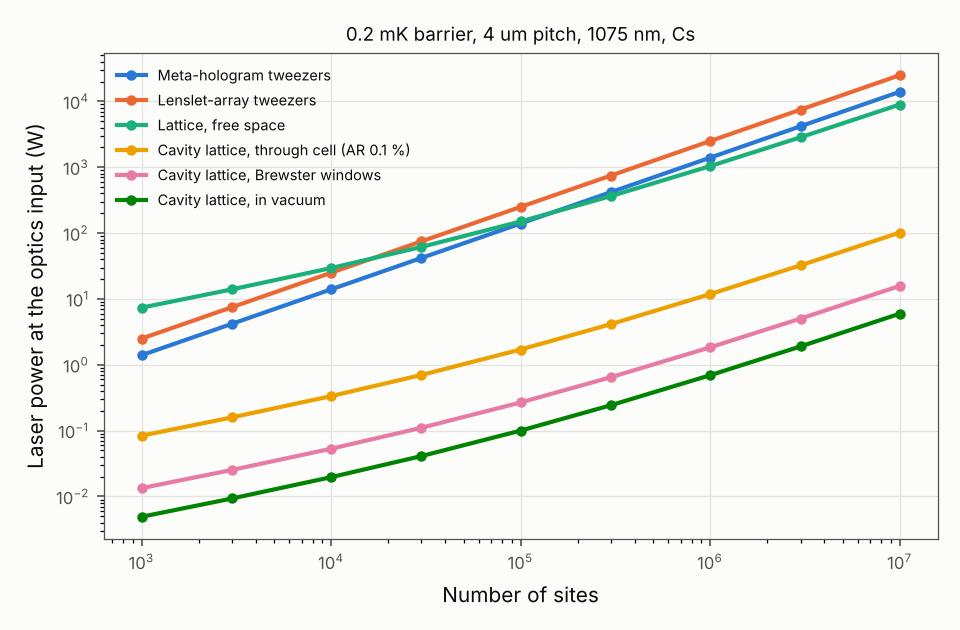
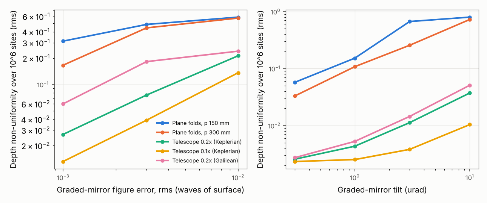

# Cavity-enhanced large-period lattice with graded-phase modes for 10^5 to 10^6 Cs sites

Technical report. Question (USER): for scaling a neutral-atom array with meta-optics to
10^5 to 10^6 sites, the limits are laser power, heat dissipation and damage by defects; can a
combination of a build-up cavity and meta-optics cut the power requirement by an order of
magnitude, and which design and simulations support it? All numbers are SIM (review before
submission) or DERIVED unless marked; SOURCE values were retrieved and read in this session.
Code: src/metatrap/cavity/, scripts/cavity_*.py, configs/cavity_*.yaml; results in
results/cavity_*/ (one params.json per run with config, git state and versions).

## Result

A build-up cavity cannot give the static meta-optic tweezer array a tenfold reduction in power.
A cavity-enhanced lattice can give more than a hundredfold, provided the mode that fills a 4 mm
array is shaped with graded-phase mirrors and made non-degenerate with an intracavity telescope.
The binding constraints then move from laser power and metasurface heating to mirror figure,
alignment stability and the cleanliness of every surface near the beam waist.

(i) Tweezers through a cavity are bounded at G <= 3.2. Any element inside the cavity is passed
twice per round trip, so the meta-hologram (array efficiency 0.83) caps the enhancement at
1 / (1 - 0.83^2) = 3.2, and the hologram with a second meta-objective at 1.8. A cavity built of
mirrors alone (concentric, NA 0.5) has a round-trip wavefront error of 0.02 to 0.03 waves rms at
100 um field and 2 to 3 waves at 1 mm, which limits a usable finesse to 3 to 5 over a few
hundred sites. Retro-reflection gives at most (1 + 0.8)^2 = 3.2 with the meta-objective.

(ii) A 4 um-pitch lattice from crossing sheet beams needs much less power than tweezers, and a
cavity multiplies it. Each lattice axis is a self-intersecting ring whose mode crosses the atom
plane twice at 2 theta = 15.4 deg. For 10^6 Cs sites at a 0.2 mK barrier per axis (1075 nm):

| Route | Power at the optics input |
|---|---|
| Meta-hologram tweezers (NA 0.55, this repository) | 1.40 kW |
| Lenslet-array tweezers (this repository) | 2.50 kW |
| Lattice in free space (two in-plane axes and one vertical axis) | 0.89 kW |
| Cavity lattice, mirrors in vacuum, over-coupled to G = 300 | 3.0 W |
| Cavity lattice, mirrors in vacuum, G = 1500 | 0.59 W |
| Cavity lattice through the present cell, AR 0.025 % / 0.1 % per surface (G 298 / 88) | 3.0 / 10 W |
| Cavity lattice through Brewster-angle windows (G 570) | 1.6 W |

At equal radial trap frequency instead of equal depth (41 kHz, which needs a 0.86 mK lattice
barrier), the in-vacuum cavity lattice needs 1.2 W at G = 1500 and 6.2 W through good AR windows.

(iii) The flat-top mode is the design problem. A Gaussian mode flat to 1 % over the array would
need a 32 mm waist and seven times more power than a flat-top. A graded-phase mirror makes a
super-Gaussian flat-top an exact eigenmode (circulating intensity flat to 0.15 % rms, barrier
depth uniform to 0.23 % rms over 10^6 sites, with negligible design loss). However, a 5.5 mm flat
mode in a 150 mm ring is nearly degenerate: the nearest transverse mode is 0.017 rad per round
trip away, with no loss discrimination. A lambda/1000 rms figure error on the graded mirror then
scrambles the depth by 31 % rms, and a 0.3 urad tilt by 6 %. A 0.2x demagnifying telescope in
each half trip removes the degeneracy. All competing modes then lose >= 1.1 % per round trip
against 1.4e-8 for the fundamental. The same lambda/1000 error then gives 2.7 % rms, and a
1 urad graded-mirror tilt 0.4 %. The tightest remaining tolerances are lambda/1000 rms figure
on the large telescope mirror (2.4 %) and sub-urad tilt stability of that mirror (1 urad: 3.7 %).

(iv) Heat is no longer a constraint; defects are. Coating absorption heats the mirrors by
< 0.5 K (IBS, 1 to 10 ppm). Every surface near the waist sees 6 to 20 kW/cm^2 at 0.2 mK,
comparable to the test masses of gravitational-wave detectors. The largest tolerable fully
absorbing defect falls to 0.36 to 1.1 um on fused silica, against 92 um for the 200 W
metasurface of the present design, and to 9 to 27 um on sapphire.

(v) Meta-optics belong outside the cavity. A pixelated metasurface as the graded mirror is too
lossy with present fabrication: 5 nm rms width noise is 0.10 to 0.15 rad of phase noise, which
costs about 1 % per bounce and limits G to about 36. The graded mirrors should be continuous
freeform surfaces under an IBS coating. The meta-optics carry the input mode converter (watts, not
kilowatts), the imaging and addressing objective (unchanged), and the loading/rearrangement
tweezers.

Main limitations. One-dimensional Fox-Li model of the horizontal profile with a separable
Gaussian vertical mode; scalar optics; static perturbations, one or two random realisations per
case; no laser frequency noise or mechanical vibration; the vertical lattice and the layout are
first-order designs, not simulated through Fox-Li.

Figure 1. Laser power at the input of the trapping optics versus the number of sites, for a
0.2 mK barrier (tweezer depth) at 1075 nm and 4 um pitch. Tweezer lines: 143 (hologram) and 80
(lenslet) mK x site / W from the Phase A simulations. Lattice lines: two in-plane axes and one
vertical axis (8 um period), flat-top x Gaussian sheets (w_z = 75 um), mode matching 0.95; cavity
enhancement for the over-coupled design T = 3L with 10 reflections of 50 ppm per round trip, plus
8 AR surfaces of 0.1 % (through cell) or 8 Brewster surfaces of 1e-4. Data: results/cavity_budget/budget.json.

## 1. Why the tweezer array cannot be cavity-enhanced tenfold

Enhancement. A ring cavity with input transmission T and all other round-trip losses L has
G = T / (1 - r)^2 on resonance, r = sqrt((1 - T)(1 - L)), with the maximum G = 1 / L at T = L
(src/metatrap/cavity/budget.py; tests/test_cavity.py). For G = 10 the round-trip loss must stay
below 10 %. An NA 0.5 tweezer array is not an eigenmode of a mirror pair; the focusing optic must
sit inside the cavity. Hence (results/cavity_tweezer_bounds/bounds.json):

| Intracavity focusing element | Passes per round trip | G_max |
|---|---|---|
| Meta-hologram, efficiency 0.83 | 2 | 3.2 |
| Pair of meta-objectives, 0.80 each | 4 | 1.7 |
| Pair of refractive objectives, 0.95 each `[VALUE?]` | 4 | 5.4 |
| Ideal AR relay, 0.995 per pass `[VALUE?]` | 4 | 50 |

Only the last line reaches 10, and it is not a meta-optic. A degenerate concentric cavity avoids
intracavity lenses: two spherical mirrors share their centre at the atoms and image every focus
onto itself. A ray trace of one reflection (NA 0.5, mirror radius 30 / 50 mm, piston, tilt and focus
removed) gives a round-trip wavefront error of 0.031 / 0.019 waves rms at 100 um field, 0.28 / 0.17
at 300 um and 3.1 / 1.9 at 1 mm. Each site must stay within a fraction of the linewidth 2 pi / F,
so the finesse is limited to 3 to 5 at 100 um and below 1 at 300 um. The mirrors would also fill
both NA 0.5 cones that imaging needs. Retro-reflecting the tweezer light through a second
objective onto a mirror gives at most (1 + sqrt(eta_return))^2, i.e. 3.2 for the meta-objective
(eta_return = 0.8^2 x 0.99) and 3.8 for a refractive one. It also forms a lambda/2 axial standing
wave in every trap.

Hence the order-of-magnitude saving must come from a different trap geometry, one whose light
does several jobs per photon (each lattice beam crosses every row of the array) and whose mode can
be supported by mirrors alone.

## 2. Architecture

Three build-up cavities, one per lattice axis, mutually detuned by >= 100 MHz so that their
interference averages out (0.36 ppm of the laser frequency; site shift 0.7 nm at the array edge).

In-plane axes. Each is a self-intersecting ring. Its mode crosses the atom plane twice, on arms A
and B, at a full angle 2 theta with sin theta = lambda / (2a) = 0.134 (theta = 7.72 deg for
a = 4 um at 1075 nm). Both crossing beams travel in the same direction, so the only fringe
period is a; a standing-wave cavity would add lambda/2 fringes along the beams. The two beams of
one axis are the same circulating mode, so their relative phase needs no separate lock. The
polarisation is vertical, perpendicular to the crossing plane, which gives full contrast. Horizontal
polarisation would allow Brewster-angle windows at a contrast cos 2 theta = 0.964.
The y-lattice ring has arms along x, and the x-lattice ring is the same ring rotated by 90 deg.

Mode. A sheet: flat-top in the plane, super-Gaussian amplitude exp(-|u/w|^20) with intensity
>= 0.99 of the flat level over the array's transverse range |u| <= (S/2)(cos theta + sin theta)
= 2.25 mm (S = 4.0 mm for 1000 x 1000 sites), giving w = 2.93 mm and an equivalent width of
5.51 mm. Vertically Gaussian with a 75 um half-thickness at the crossing. Its Rayleigh range of
16.4 mm keeps the depth roll-off along the beams within 1 % over the array.

Graded-phase mirrors and telescope. Each half trip (crossing, arm A, to crossing, arm B) is
symmetric about a graded-phase mirror G. With the target flat-top F at the crossing, the phase
phi_G = -2 arg(K F), K the propagation from the crossing to G, returns conj(K F), and the
symmetric return path then gives conj(F) = F. Hence F is an exact eigenmode of any lossless
symmetric half trip (the graded-phase resonator of Belanger and Pare, Opt. Lett. 16, 1057 (1991),
DOI 10.1364/OL.16.001057, abstract read in session). The design adopted in Section 4 puts a
0.2x Keplerian telescope of cylindrical mirrors in each half trip: primary P1 (f = 100 mm) 50 mm
from the crossing, secondary P2 (f = 20 mm) 120 mm further, and G 100 mm beyond P2. Half trip
270 mm, round trip 1.08 m, free spectral range 278 MHz. The round trip has 10 reflections, all
mirrors near 0 to 38 deg incidence (results/cavity_layout/layout.json).

Vertical mode. A 30 mm vertical focal length on P1 and a 166 mm vertical radius on G give the
75 um waist with a half-trip stability parameter m = 0.07, a round-trip Gouy phase of -0.29 rad
(mod 2 pi), 0.24 mm on P1 and 0.65 mm on G, and a 0.4 % waist change per 0.1 % radius error.

Vertical confinement. The in-plane sheets alone give 0.7 kHz vertically (Gaussian profile of 75 um, 0.4 mK at the site). A third ring crosses at
2 theta_z in a vertical plane (period 8 um, theta_z = 3.85 deg), propagating along the array
diagonal. Its beams walk off vertically by +-0.19 mm across the array, so they must be flat-topped
vertically as well (equivalent height 0.47 mm, width 6.9 mm). This axis takes 638 W of the
843 W circulating at 10^6 sites and 0.2 mK; Section 3 discusses alternatives.

Meta-optics. (i) Input mode converters, Gaussian to flat-top sheet (a Gaussian input couples
0.918 of the power into the flat-top mode; a flat-top converter is assumed to reach 0.95, `[VALUE?]`);
(ii) the 852 nm imaging and addressing objective (docs/metalens_report.md, docs/million_sites.md);
(iii) tweezers for loading and rearrangement. None of them sees the circulating power.

Precedents. A two-cavity Sr lattice reached finesse 5025 and power enhancement 1132 at 914 nm,
489 um waists, 80 mW per arm and ~92 W circulating, in a monolithic ULE assembly in vacuum, with
mirror losses ~100 ppm. The authors report that the overlap sensitivity to misalignment scales as
the fourth power of the waist, and attribute 1 % fringes to an accidental degeneracy with a high-order
mode (Park et al., PRX Quantum 3, 030314 (2022), arXiv:2110.08073, full text read in session).
Atom Computing used two self-intersecting cavities (finesse 2900 and 3000, waists 268 and 183 um)
for imaging 1225 Yb sites, with roughly two orders of magnitude lower power than tweezers and
<= 50 ppm loss per mirror (Norcia et al., PRX Quantum 5, 030316 (2024), arXiv:2401.16177, HTML read
in session). Both precedents cover arrays of 0.1 to 1 mm with Gaussian modes. Neither shaped a flat
mode over several millimetres, and neither addressed the degeneracy that such a mode brings.

## 3. Power and loss budget

Model (results/cavity_budget/budget.json). Each crossing beam needs the peak intensity
I1 = U / (4 c kappa), with kappa = 2.53e-13 K per W/m^2 for Cs at 1075 nm (Steck polarisability,
alpha = 1125 a.u.), i.e. 19.8 kW/cm^2 for U = 0.2 mK. The circulating power per in-plane axis is
I1 x W_eq x sqrt(pi/2) w_z, independent of the number of beams per axis because one mode supplies
both. The power scales as the array side, sqrt(N), against N for tweezers.

| N, barrier | Per in-plane axis | Vertical axis | Total circulating | Hologram tweezers |
|---|---|---|---|---|
| 10^5, 0.2 mK | 32 W | 64 W | 128 W | 140 W |
| 10^5, 0.3 mK | 48 W | 95 W | 192 W | 210 W |
| 10^6, 0.2 mK | 102 W | 638 W | 843 W | 1,399 W |
| 10^6, 0.3 mK | 154 W | 957 W | 1,264 W | 2,098 W |

The hologram column reproduces the 210 W of docs/scaling_100k.md for 10^5 sites at 0.3 mK.

Round-trip loss and enhancement (10 reflections of 50 ppm; per-mirror bound of Norcia et al.):

| Placement | Round-trip loss L | G_max = 1/L | G at T = 3L (finesse) |
|---|---|---|---|
| Mirrors in vacuum | 5.0e-4 | 2000 | 1500 (3140) |
| In vacuum, graded mirrors +1e-3 each | 2.5e-3 | 400 | 300 (627) |
| In vacuum, graded mirrors +1e-2 each (metasurface) | 2.0e-2 | 49 | 36 (75) |
| Through the cell, 8 AR surfaces at 2.5e-4 `[VALUE?]` | 2.5e-3 | 398 | 298 (623) |
| Through the cell, 8 AR surfaces at 1e-3 `[VALUE?]` | 8.5e-3 | 118 | 88 (183) |
| Through the cell, 8 Brewster surfaces at 1e-4 `[VALUE?]` | 1.3e-3 | 760 | 570 (1192) |

We take the over-coupled coupler T = 3L as the design point. It gives 0.75 of the maximum
enhancement at half the finesse, and the enhancement then depends weakly on the exact loss.
Section 4 shows that the depth tolerances do not depend on the finesse between 47 and 7000.
A further reason to stay well below G_max is the cavity linewidth (88 kHz at G = 1500, about 0.5 MHz at
G = 300; free spectral range 278 MHz). It converts laser frequency noise into intensity noise, which Norcia et al. identify as a
heating source (190 ms time constant). We therefore recommend G ~ 300 in vacuum (3.0 W for 10^6
sites at 0.2 mK) and use G = 1500 as the upper bound.

The vertical axis dominates at 10^6 sites because its beams must be flat over the vertical
walk-off. Three options reduce it, none simulated here: (i) a larger vertical period (power scales
as 1 / a_z; frequency as 1 / a_z); (ii) propagation along an array side instead of the diagonal
(about half the power, at the cost of mirror clearance with one in-plane ring); (iii) a lower
vertical barrier, if imaging tolerates it. Without the vertical axis the in-plane lattices need
205 W circulating at 10^6 sites, 0.7 W at G = 300.

## 4. The flat-top cavity mode (Fox-Li)

Method (scripts/cavity_foxli.py, configs/cavity_foxli.yaml; results/cavity_foxli/foxli.json).
One-dimensional strip model of the horizontal profile on 8192 points over 24 mm (2.9 um), exact
scalar angular-spectrum propagation, hard apertures at every mirror, graded-phase design through
the actual elements. The vertical profile is separable (a separable 2D propagation agrees with
the product of 1D propagations to 2e-3, tests/test_cavity.py). The driven steady state
(I - r e^{i psi} R) E = t E_in is solved by GMRES. The laser is locked to the psi of maximum
circulating power, found by re-centring on the round-trip phase of the circulating field
followed by a golden-section search. The field of arm A at the crossing and its image after the
half trip (arm B) are propagated across the array, combined with the vertical Gaussian (width and
Gouy phase), and sampled at 101 x 101 sites spanning the 10^6-site array. Metrics: rms and
min / mean of the barrier depth, and the site displacement along the fringe normal with and without
its affine part (a uniform pitch change or rotation is a calibration, not an error). Unless stated,
the input is the target flat-top, G = 300, lumped loss 3e-4. Anchors: the strip Gaussian mode of a
plane-concave design and its TEM1 Gouy phase (to 1e-4), and the driven enhancement against
T / (1 - r)^2 (to 1e-4) (tests/test_cavity.py). The results do not change between 4096, 8192 and
16384 points (depth rms 0.23148 / 0.23149 / 0.23149 %).

Ideal designs. Every design reproduces the target. Over 10^6 sites the barrier depth is uniform
to 0.23 % rms (min / mean 0.990, set by the 1 % design tolerance at the flat edge). The site
displacement is 6 nm rms, all of it affine (residual 0.03 nm), from the differential Gouy phase of
the two sheets.

| Design | Fresnel number w^2 / (lambda p) | Fundamental loss per round trip | Nearest competing mode (phase, loss) | Graded mirror PV, max deflection |
|---|---|---|---|---|
| Plane folds, p = 150 mm | 53 | 8e-10 | 0.017 rad, 2e-9 | 5.9 rad, 0.004 |
| Plane folds, p = 300 mm | 27 | 1e-9 | 0.033 rad, 6e-8 | 9.0 rad, 0.004 |
| Plane folds, p = 600 mm | 13 | 3e-6 | 0.067 rad, 8e-6 | 13 rad, 0.003 |
| Telescope 0.2x, Keplerian | - | 1.4e-8 | all modes lose >= 1.1e-2 | 24 rad, 0.013 |
| Telescope 0.1x, Keplerian | - | 2.3e-8 | all modes lose >= 1.4e-2 | 36 rad, 0.026 |
| Telescope 0.2x, Galilean | - | 2.6e-6 | 0.33 rad, 1.5e-3 | 30 rad, 0.013 |

Spectra by full diagonalisation of the round trip on 4096 points. Edge order: n = 10 and 40 give
the same uniformity (0.24 / 0.23 %) at equivalent widths of 6.78 / 4.98 mm against 5.51 mm for n = 20.
In the telescope ring, n = 40 raises the design loss from 1.4e-8 to 3.4e-5 and brings a competing
mode to 4.7e-3 loss, so n = 20 is the compromise between power efficiency and edge diffraction.

Why the plain design fails. With plane folds, the mode spacing is about lambda p / w^2, the
inverse Fresnel number of the flat mode: 0.017 rad at p = 150 mm and 0.067 rad at 600 mm, with
no loss difference. A perturbation of round-trip phase delta phi mixes the nearest mode into the
fundamental with an amplitude of about delta phi / 0.017. A lambda/1000 surface error (12.6 mrad of
reflected phase) is then an order-one admixture. This is the flat-top counterpart of the
waist^4 alignment sensitivity of large Gaussian modes noted by Park et al. Curved folds do not help:
a single cylindrical fold raised the spacing to at most 0.025 rad, and Fourier-transform
configurations made it smaller (exploratory runs, not in the results file).

The telescope. A demagnifying telescope of magnification M makes the remaining path L to the graded
mirror act, seen from the crossing, like a path L / M^2. The mode on G then has a Fresnel number
near 1, the Belanger-Pare regime of strong mode discrimination. In the 0.2x design every competing
mode loses at least 1.1 % per round trip, a million times the fundamental's loss.

Tolerances (median over two random realisations and correlation lengths of 0.5 and 2 mm referred to
the crossing; figure errors as rms surface height over the beam, reflected phase 4 pi h / lambda;
both graded mirrors perturbed independently, tilts and curvature errors on one mirror):

Entries: barrier-depth non-uniformity over the 10^6-site array (rms, median over realisations)
and, in parentheses, the lowest enhancement relative to the analytic value. K Keplerian, G Galilean;
P1 is the large telescope primary. Generated by scripts/cavity_report_tables.py.

| Perturbation | Plane folds, 150 mm | Plane folds, 300 mm | Telescope 0.2x K | Telescope 0.1x K | Telescope 0.2x G |
|---|---|---|---|---|---|
| G figure, rms, 0.001 waves | 31 % (0.61) | 17 % (0.84) | 2.7 % (0.97) | 1.3 % (0.98) | 6 % (0.94) |
| G figure, rms, 0.003 waves | 49 % (0.42) | 44 % (0.41) | 7.6 % (0.78) | 3.9 % (0.82) | 18 % (0.59) |
| G figure, rms, 0.01 waves | 59 % (0.15) | 57 % (0.19) | 21 % (0.36) | 14 % (0.21) | 24 % (0.08) |
| P1 figure, rms, 0.001 waves | - | - | 2.4 % (0.99) | 1.3 % (0.96) | 8.5 % (0.90) |
| P1 figure, rms, 0.003 waves | - | - | 7.4 % (0.90) | 3.9 % (0.73) | 25 % (0.41) |
| P1 figure, rms, 0.01 waves | - | - | 26 % (0.14) | 14 % (0.09) | 60 % (0.08) |
| G x^2 sag at beam half-width, 0.001 waves | 5.7 % (1.00) | 2.8 % (1.00) | 0.82 % (1.00) | 0.3 % (1.00) | 0.87 % (1.00) |
| G x^2 sag at beam half-width, 0.003 waves | 18 % (0.98) | 8.7 % (1.00) | 2.6 % (0.98) | 0.65 % (0.99) | 2.9 % (0.99) |
| G x^2 sag at beam half-width, 0.01 waves | 61 % (0.86) | 31 % (0.96) | 12 % (0.70) | 2 % (0.90) | 5.5 % (0.78) |
| G tilt, 0.3 urad | 5.7 % (0.92) | 3.3 % (0.97) | 0.26 % (1.00) | 0.23 % (1.00) | 0.27 % (1.00) |
| G tilt, 1 urad | 15 % (0.68) | 11 % (0.83) | 0.43 % (1.00) | 0.25 % (1.00) | 0.53 % (1.00) |
| G tilt, 3 urad | 67 % (0.39) | 26 % (0.58) | 1.1 % (1.00) | 0.38 % (1.00) | 1.4 % (1.00) |
| G tilt, 10 urad | 80 % (0.26) | 73 % (0.33) | 3.7 % (0.97) | 1 % (0.99) | 5.1 % (0.96) |
| P1 tilt, 0.3 urad | - | - | 1.1 % (1.00) | 0.6 % (1.00) | 0.73 % (1.00) |
| P1 tilt, 1 urad | - | - | 3.7 % (0.97) | 1.9 % (0.99) | 2.4 % (0.99) |
| P1 tilt, 3 urad | - | - | 11 % (0.83) | 5.8 % (0.93) | 8.1 % (0.91) |
| P1 tilt, 10 urad | - | - | 33 % (0.56) | 20 % (0.61) | 24 % (0.59) |

Reading the table. (i) The telescope reduces the sensitivity to graded-mirror figure 6 to 11 fold and to
graded-mirror tilt 20 to 60 fold. (ii) The large primary P1 now carries the
tightest tolerances. A lambda/1000 rms figure error there gives 2.4 % rms, and a 1 urad tilt 3.7 %.
(iii) The 0.1x telescope halves these numbers but doubles the intensity on the small mirrors
(Section 5). (iv) The Galilean form is 2 to 3.5 times more sensitive to figure errors than the Keplerian at
the same magnification, though slightly less sensitive to primary tilt, because its design loss
and its nearest mode (0.33 rad, 1.5e-3 loss) are closer to the fundamental. (v) The finesse barely matters. With a fixed lambda/300 figure error,
the depth non-uniformity is 5.2 to 5.7 % at G = 30, 100, 300, 1000 and 3000 (finesse 47 to 7159),
because the admixture is set by the mode spacing, not by the linewidth.

Input mismatch is filtered by the cavity. A flat-top input 2 % too narrow or too wide, or offset by
100 um, changes the depth uniformity by < 0.02 percentage points and the enhancement by <= 0.6 %. A
Gaussian input with the optimal waist couples 0.918 of its power and changes the uniformity from
0.23 to 0.42 % rms. Hence the extracavity mode converter, the meta-optic role, needs only modest
accuracy.

A plain cavity without graded mirrors (plane folds and telescope, same flat-top input) gives 12 to
22 % rms and 0.86 to 0.87 of the enhancement: the flat-top is not its eigenmode.

Metasurface realisation of the graded phase. Quantising phi_G to 8, 16 or 32 levels gives 19, 12
and 4.5 % rms, at 0.14, 0.23 and 0.52 of the ideal enhancement. White pixel phase noise of 0.02, 0.05 and 0.1 rad gives 1.5, 3.8 and 7.4 % rms and
reduces the enhancement to 0.89, 0.52 and 0.15 of the ideal. The repository's SiN libraries at 1075 nm
(LPCVD and Si-rich, p = 0.45 to 0.5 um, h = 1.3 to 1.6 um, data/library_main.h5,
data/library_est_1075.h5) give a phase slope of 19 to 31 rad/um over the 2 pi range. Hence 5 nm rms
width noise is 0.10 to 0.15 rad in transmission, and about twice that in a reflective double pass
(an estimate; no reflective library was simulated). The noise model sets white noise per 2.9 um grid
cell, so it overstates the mode distortion from 0.5 um pixels, whose scatter leaves the cavity at
large angles. The loss, about sigma^2 per bounce, is model-independent. A metasurface graded mirror
therefore needs sub-nanometre width control, or it must accept G ~ 36. The required phase is smooth
(24 rad PV, deflection <= 0.013), so a continuous freeform surface (diamond turning, magnetorheological
or ion-beam figuring) under an IBS coating is the natural realisation `[REF?: freeform figuring at
nm rms over mm apertures]`.

Figure 2. Barrier-depth non-uniformity over the 10^6-site array (rms over 101 x 101 sampled sites)
versus the rms figure error of both graded mirrors (left, median over realisations) and the tilt of
one graded mirror (right), for plane-fold rings of p = 150 and 300 mm and for telescope rings.
Fox-Li strip model, 8192 points, G = 300, flat-top input, w_z = 75 um. Data:
results/cavity_foxli/foxli.json.

## 5. Intensities, defects and heating inside the cavity

Model (scripts/cavity_thermal.py; results/cavity_thermal/thermal.json). Each beam's peak intensity
at the atoms is I1, set by the barrier depth. On a mirror it is I1 times the one-dimensional peak
ratio from Fox-Li (5.7 on P2 and 6.5 on G for the 0.2x design), times the vertical size ratio
from Section 2. The defect criterion is that of thermal/damage.py: a fully absorbing disc of
radius a on a half-space heats by I a / kappa, limited to 50 K.

| Surface (0.2 mK, 10^6 sites) | Peak intensity | Largest absorbing defect, fused silica / sapphire |
|---|---|---|
| Cell wall, 15 mm from the atoms `[CONFIRM?]` (through-cell variant) | 14.6 kW/cm^2 | 0.47 / 11 um |
| Telescope primary P1 | 6.2 kW/cm^2 | 1.1 / 27 um |
| Telescope secondary P2 | 19.1 kW/cm^2 | 0.36 / 8.6 um |
| Graded mirror G | 14.8 kW/cm^2 | 0.47 / 11 um |
| Vertical ring, mirror with 3x beam expansion | 2.2 kW/cm^2 | 3.1 / 75 um |

At equal radial frequency (0.86 mK) every intensity is 4.3x higher and the defect limits 4.3x
smaller (0.08 to 0.26 um on fused silica). For comparison, the present 18.4 mm metasurface at 200 W
sees 75 W/cm^2 and tolerates 92 um (docs/prefab_checks_report.md). The cavity therefore trades a
kilowatt laser and a hot metasurface for watt-level input and mirrors at kW/cm^2. Point absorbers at
these intensities limit the stored power of Advanced LIGO (Brooks et al., Appl. Opt. 60, 4047
(2021), DOI 10.1364/AO.419689, abstract read in session). The fully absorbing disc model is
pessimistic for sub-micron particles, whose absorption cross-section is below the geometric one.

Thermal deformation of the graded mirror (102 W circulating, equal-area disc of 0.47 mm radius on a
1 inch, 6.35 mm fused-silica or sapphire mirror, surface bulge (1 + nu) alpha int T dz):

| Absorber on G | Absorbed power | Surface temperature rise | Bulge, centre to edge | Bulge rms over the spot |
|---|---|---|---|---|
| IBS HR, 1 ppm `[VALUE?]` | 0.1 mW | 0.05 K | 0.004 nm | 1e-6 waves |
| IBS HR, 10 ppm | 1 mW | 0.5 K | 0.035 nm | 1e-5 waves |
| LPCVD SiN metasurface (3.5e-6) | 0.36 mW | 0.17 K | 0.012 nm | 3e-6 waves |
| Si-rich SiN metasurface (5.9e-4), fused silica | 60 mW | 29 K | 2.1 nm | 5.6e-4 waves |
| Si-rich SiN metasurface (5.9e-4), sapphire | 60 mW | 1.2 K | 0.9 nm | 2.4e-4 waves |

With IBS coatings the deformation is three orders of magnitude below the lambda/1000 figure
tolerance. A Si-rich SiN film inside the cavity would reach the tolerance on its own. The cell
windows (through-cell variant) absorb 4 ppm per pass in bulk (0.4 mW at 102 W), which is negligible
thermally. Their surfaces carry the defect constraint of the table above, the reason to prefer
mirrors in vacuum.

## 6. Site quality and registration

Trap frequencies (scripts/cavity_lattice.py; results/cavity_lattice/lattice.json; plane-wave model,
numerical Hessian, equal to the analytic (pi / a) sqrt(2U / m) to 1e-6):

| Barrier per axis | In-plane | Vertical (8 um) | Tweezer of the same depth, radial / axial |
|---|---|---|---|
| 0.2 mK | 19.8 kHz | 9.9 kHz | 41.1 / 11.5 kHz |
| 0.3 mK | 24.2 kHz | 12.1 kHz | 50.4 / 14.1 kHz |
| 0.86 mK | 41.0 kHz | 20.5 kHz | 85.3 / 23.8 kHz |

At equal depth the lattice site has 0.48 of the tweezer's radial frequency, because its cos^2
well spans the full pitch. Equal radial frequency therefore costs a factor 4.3 in depth and power.
A cost that the power table hides is the light shift at the site: each of the three incoherent axes
reaches 4 I1 there, twice its mean, so the atoms sit at 3U of light shift (0.6 mK for a 0.2 mK
barrier), against U in a tweezer. Differential light shifts
and their noise are three times larger at equal barrier depth.

Registration. A differential wavefront error dw between the two beams of an axis moves a site by
dw / (2 sin theta) = 3.7 nm per nm. A crossing-angle change of 1 urad changes the pitch by
cot(theta) x 1 urad = 7.4 ppm and moves the edge sites by 15 nm. A wavelength change of 1 ppm moves
them by 2 nm. A change dL of the optical path between the two crossings of one ring shifts that
lattice rigidly by dL / (2 sin theta), 3.7 nm per nm; the shift is common to all sites and can be
tracked, but it sets the path-stability requirement between the crossings. In the Fox-Li tolerance cases the non-affine site displacement is at most 37 nm rms
for every telescope case with depth non-uniformity below 5 %. Hence site positions are stable to a
small fraction of the 4 um pitch, provided the crossing angle is held to ~1 urad. The rearrangement
and addressing optics must be registered to the lattice, as in the Atom Computing scheme.

Layout (results/cavity_layout/layout.png). The two in-plane rings fit within about 270 mm. In this
first sketch the secondary mirrors of the two rings come within ~10 mm of each other, so one ring
must be scaled or folded differently. The vertical ring and the vertical NA 0.5 objective are not
yet placed.

## 7. What must improve, and next steps

What must improve. (i) Figure and alignment of the large telescope mirrors: lambda/1000 rms
uncompensated figure and < 1 urad tilt stability for <= 4 % depth non-uniformity. Static errors
that are measured can be absorbed into the graded-phase design, which is computed through the actual
propagation. Hence the tolerance applies to the unmeasured and drifting part. Drift at the urad level
calls for a monolithic, low-expansion assembly as in Park et al. (ii) Cleanliness of every surface
near the waist at the level of point absorbers below ~0.5 um on fused silica, or sapphire substrates
(23x more tolerant). (iii) Losses of the graded mirrors <= 1e-3 per bounce, i.e. figured surfaces
rather than metasurfaces. (iv) The vertical lattice power, which dominates at 10^6 sites. (v)
Single-plane loading in an 8 um vertical lattice and site-resolved rearrangement into the lattice;
neither is studied here.

Next simulations. (i) Two-dimensional Fox-Li of the vertical ring (flat in both directions), and of
the in-plane ring with a non-separable mirror error. (ii) Laser frequency noise and mirror vibration:
time-dependent depth and site position, heating rates versus finesse. (iii) Absorption-induced
deformation fed back into Fox-Li at the circulating power (here only compared with the tolerance).
(iv) A tolerance budget in which static errors are measured and compensated in the design, leaving
only metrology noise and drift. (v) The mirror layout of all three rings around the cell and the
imaging objective.

## Verification notes

Provenance ledger:

| Value | Location | Type | Pointer |
|---|---|---|---|
| Power budget, losses, enhancements | Result, Sections 1, 3 | DERIVED (code) | results/cavity_budget/budget.json |
| Tweezer anchors 143 and 80 mK x site / W | Section 3 | SIM (earlier runs) | docs/scaling_100k.md, docs/million_sites.md |
| Cs depth per intensity 2.53e-13 K / (W/m^2) | Section 3 | DERIVED from SOURCE | atoms/alkali.py (Steck data) |
| Concentric ray trace | Section 1 | SIM, review before submission | results/cavity_tweezer_bounds/bounds.json |
| Fox-Li designs, spectra, tolerances | Sections 4, Result | SIM, review before submission | results/cavity_foxli/foxli.json (field .npz files are regenerated by the script, not versioned) |
| Exploratory curved-fold spectra | Section 4 | SIM (exploratory, not saved) | session scratch scripts |
| Lock correction | Section 4 | SIM | 104 strongly perturbed cases were rerun with the self-consistent lock (25 had locked off the fundamental); their earlier values are in results/cavity_foxli/relock_before.json |
| SiN phase slope vs width | Section 4 | DATA (analysis of library) | data/library_main.h5, data/library_est_1075.h5 |
| Vertical Gaussian design, layout | Section 2, 6 | DERIVED (code) | results/cavity_layout/layout.json |
| Intensities, defects, deformation | Section 5 | SIM / DERIVED, review before submission | results/cavity_thermal/thermal.json |
| Trap frequencies, registration | Section 6 | DERIVED (code) | results/cavity_lattice/lattice.json |
| Gaussian waist 32 mm and 7x power for 1 % flatness | Result | DERIVED | w = h sqrt(2 / -ln 0.99); ratio sqrt(pi/2) w / W_eq |
| Sheet-only vertical frequency 0.7 kHz | Section 2 | DERIVED | sqrt(4 x 2U / (m w_z^2)) |
| Park et al.: F 5025, G 1132, 489 um, 80 mW, ~92 W, ~100 ppm, w^4 sensitivity, 1 % fringes | Section 2 | SOURCE | arXiv:2110.08073 (PDF text read in session) |
| Norcia et al.: F 2900 / 3000, waists 268 / 183 um, <= 50 ppm per mirror, 1225 sites, ~100x, 190 ms heating | Sections 2, 3 | SOURCE | arXiv:2401.16177v3 (HTML read in session) |
| Belanger and Pare graded-phase resonator | Section 2 | SOURCE (abstract) | DOI 10.1364/OL.16.001057 |
| LIGO point absorbers | Section 5 | SOURCE (abstract) | DOI 10.1364/AO.419689, arXiv:2101.05828 |

Open placeholders: `[VALUE?: AR loss per surface 2.5e-4 to 1e-3]`, `[VALUE?: Brewster residual loss
1e-4]`, `[VALUE?: IBS absorption 1 ppm]`, `[VALUE?: refractive objective 0.95, ideal relay 0.995 per
pass]`, `[VALUE?: mode-converter coupling 0.95]`, `[CONFIRM?: cell wall 15 mm from the atoms; cell
size for the layout]`, `[REF?: freeform figuring at nm rms over mm apertures]`.

Sourcing gaps. The 12,000-finesse microstructured-mirror cavity (Dickmann et al., Commun. Phys. 2023,
DOI 10.1038/s42005-023-01131-1) and the Si3N4 photonic-crystal membrane mirror (arXiv:2401.16695,
R ~ 99 %) were seen only in search snippets and are not used for any number. The Weiss group's
large-spacing Cs lattice (Nelson, Li and Weiss, Nat. Phys., DOI 10.1038/nphys645) is a relevant
precedent for imaging single atoms at ~5 um spacing; its spacing (4.5 or 5 um) is unverified.
