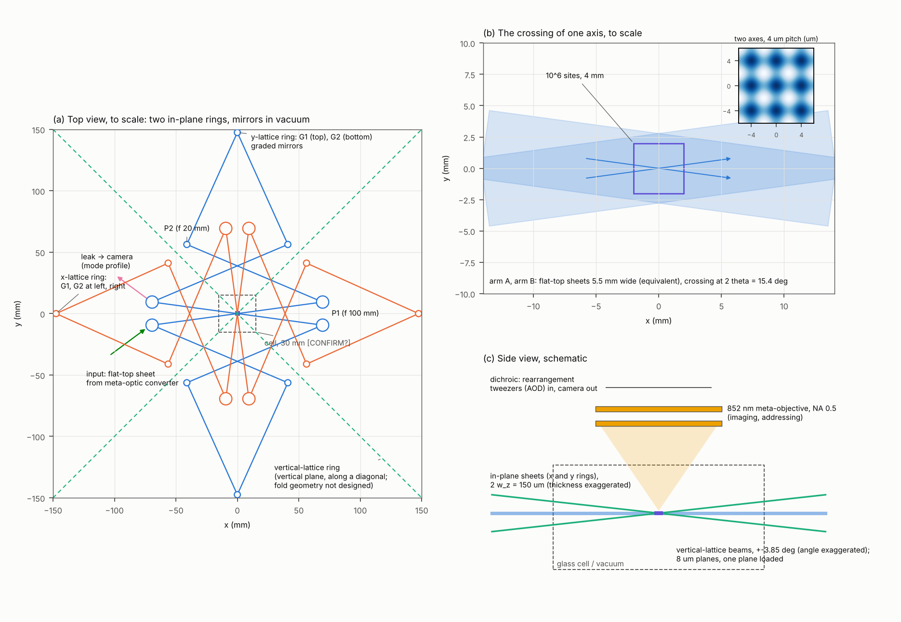
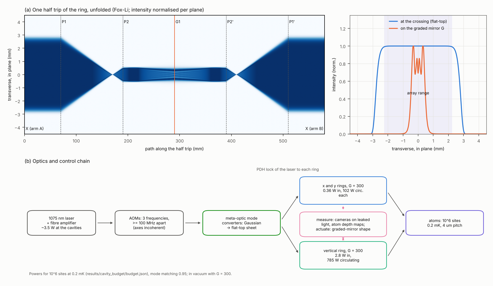
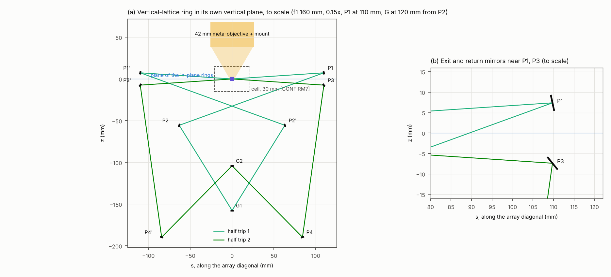
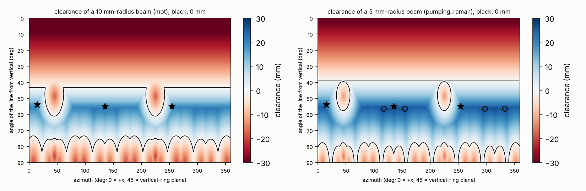

# Cavity-enhanced large-period lattice with graded-phase modes for 10^5 to 10^6 Cs sites

Technical report. Question (USER): for scaling a neutral-atom array with meta-optics to
10^5 to 10^6 sites, the limits are laser power, heat dissipation and damage by defects; can a
combination of a build-up cavity and meta-optics cut the power requirement by an order of
magnitude, and which design and simulations support it? All numbers are SIM (review before
submission) or DERIVED unless marked; SOURCE values were retrieved and read in this session.
Code: src/metatrap/cavity/, scripts/cavity_*.py, configs/cavity_*.yaml; results in
results/cavity_*/ (one params.json per run with config, git state and versions).

## Result

A build-up cavity cannot give the static meta-optic tweezer array a tenfold reduction in power.
A cavity-enhanced lattice can give more than a hundredfold, provided the mode that fills a 4 mm
array is shaped with graded-phase mirrors and made non-degenerate with an intracavity telescope.
The binding constraints then move from laser power and metasurface heating to mirror figure,
alignment stability and the cleanliness of every surface near the beam waist.

(i) Tweezers through a cavity are bounded at G <= 3.2. Any element inside the cavity is passed
twice per round trip, so the meta-hologram (array efficiency 0.83) caps the enhancement at
1 / (1 - 0.83^2) = 3.2, and the hologram with a second meta-objective at 1.8. A cavity built of
mirrors alone (concentric, NA 0.5) has a round-trip wavefront error of 0.02 to 0.03 waves rms at
100 um field and 2 to 3 waves at 1 mm, which limits a usable finesse to 3 to 5 over a few
hundred sites. Retro-reflection gives at most (1 + 0.8)^2 = 3.2 with the meta-objective.

(ii) A 4 um-pitch lattice from crossing sheet beams needs much less power than tweezers, and a
cavity multiplies it. Each lattice axis is a self-intersecting ring whose mode crosses the atom
plane twice at 2 theta = 15.4 deg. For 10^6 Cs sites at a 0.2 mK barrier per axis (1075 nm):

| Route | Power at the optics input |
|---|---|
| Meta-hologram tweezers (NA 0.55, this repository) | 1.40 kW |
| Lenslet-array tweezers (this repository) | 2.50 kW |
| Lattice in free space (two in-plane axes and one vertical axis) | 1.04 kW |
| Cavity lattice, mirrors in vacuum, over-coupled to G = 300 | 3.5 W |
| Cavity lattice, mirrors in vacuum, G = 1500 | 0.69 W |
| Cavity lattice through the present cell, AR 0.025 % / 0.1 % per surface (G 298 / 88) | 3.5 / 12 W |
| Cavity lattice through Brewster-angle windows (G 570) | 1.8 W |

At equal radial trap frequency instead of equal depth (41 kHz, which needs a 0.86 mK lattice
barrier), the in-vacuum cavity lattice needs 1.4 W at G = 1500 and 6.9 W through good AR windows.

(iii) The flat-top mode is the design problem. A Gaussian mode flat to 1 % over the array would
need a 32 mm waist and seven times more power than a flat-top. A graded-phase mirror makes a
super-Gaussian flat-top an exact eigenmode (circulating intensity flat to 0.15 % rms, barrier
depth uniform to 0.23 % rms over 10^6 sites, with negligible design loss). However, a 5.5 mm flat
mode in a 150 mm ring is nearly degenerate: the nearest transverse mode is 0.017 rad per round
trip away, with no loss discrimination. A lambda/1000 rms figure error on the graded mirror then
scrambles the depth by 31 % rms, and a 0.3 urad tilt by 6 %. A 0.2x demagnifying telescope in
each half trip removes the degeneracy. All competing modes then lose >= 1.1 % per round trip
against 1.4e-8 for the fundamental. The same lambda/1000 error then gives 2.7 % rms, and a
1 urad graded-mirror tilt 0.4 %. The tightest remaining tolerances are lambda/1000 rms figure
on the large telescope mirrors (2.4 %) and sub-urad tilt stability of those mirrors (1 urad: 3.7 %).

(iii-b) The residual can be corrected by re-shaping the two graded mirrors, because each axis's
depth map is the product of the two crossing beams' profiles and each graded mirror shapes one of
them. With independent lambda/1000 figure errors or 1 urad tilts on all ten mirrors, which give
1.2 to 4.8 % uncorrected, closed-loop feedback on depths measured with the atoms (six rounds, no
mirror metrology, insensitive to 1 % per-site noise) restores 0.22 to 0.54 % in four of six runs;
the other two end at 1.9 and 2.3 % (the latter with 0.5 mm-scale errors). It needs a graded-mirror change of only 1 to 7 nm rms. A 2D
model with non-separable errors gives the same picture (2.2 % to 0.44 % with an x-only correction).
The feedback fails when the uncorrected mode is far from the design (a 22 % start diverged). A camera on the
transmitted beams does as well (0.49 to 1.3 % for lambda/1000) and does not diverge where the atom
loop did. Open-loop correction from measured mirror maps needs 0.1 to 0.3 nm rms metrology on every
mirror, after coating and as mounted, which is beyond what LIGO- or EUV-class interferometry provides in
situ; such metrology serves fabrication, not correction. The
vertical-lattice ring, whose beam is 6.9 mm wide, is the most sensitive (3.6 to 36 % uncorrected,
0.08 % after a perfect-metrology redesign). Correction does not rescue the plain ring without a
telescope. All corrections are static; drift must stay below these levels between corrections.

(iv) Heat is no longer a constraint; defects are. Coating absorption heats the mirrors by
< 0.5 K (IBS, 1 to 10 ppm). Every surface near the waist of the in-plane rings sees 4.5 to 19 kW/cm^2 at 0.2 mK,
comparable to the test masses of gravitational-wave detectors. The largest tolerable fully
absorbing defect falls to 0.36 to 1.5 um on fused silica, against 92 um for the 200 W
metasurface of the present design, and to 9 to 37 um on sapphire. The vertical ring, which carries
785 of the 989 W, is worse: as folded in Figure 5 its mirrors see 14 to 170 kW/cm^2 (defects
<= 0.04 um on fused silica, 1 um on sapphire). An added 4x to 8x vertical telescope lowers this to
27 to 55 kW/cm^2 (0.13 to 0.19 um, or 3 to 4.4 um on sapphire), at the cost of a larger figure-error
sensitivity of its vertical profile (Section 5).

(v) Meta-optics belong outside the cavity. A pixelated metasurface as the graded mirror is too
lossy with present fabrication: 5 nm rms width noise is 0.10 to 0.15 rad of phase noise, which
costs about 1 % per bounce and limits G to about 36. The graded mirrors should be continuous
freeform surfaces under an IBS coating. The meta-optics carry the input mode converter (watts, not
kilowatts), the imaging and addressing objective (unchanged), and the loading/rearrangement
tweezers.

(vi) The arrangement fits around the atoms (Figures 3 and 5). The two in-plane rings lie in the
atom plane, the vertical-lattice ring in a vertical plane on one diagonal, folded entirely below the
atoms, and the space above the atoms stays free for the NA 0.5 imaging objective. A standard MOT is
blocked, but a six-beam MOT with its axes tilted about 55 deg from vertical fits with >= 15.9 mm
clearance for 20 mm beams, and four further lines remain for optical pumping and Raman beams
(Section 6b). A single-beam grating MOT also fits geometrically, but demonstrated Cs grating MOTs
(7e6 atoms) are one to two orders of magnitude short of a single-shot load of 10^6 sites.

(vii) Noise sets the next requirement (Section 6c). For a 10 s heating time of 10 uK atoms at
0.2 mK, the input needs a relative intensity noise below -106 dBc/Hz at 40 kHz, the residual
laser-cavity detuning must stay below 22 Hz/rtHz (7 kHz rms, 1.7 % of the linewidth) at G = 300 and
five times less at G = 1500, and each ring mirror must move by less than 0.32 pm/rtHz at the 20 kHz
trap frequency. The last calls for a monolithic ring assembly with controlled mechanical resonances.

Main limitations. One-dimensional Fox-Li model of the horizontal profile with a separable
Gaussian vertical mode, checked by one 2D case per question (ideal design, non-separable errors and
their correction); scalar optics; static perturbations, one or two random realisations per case;
noise treated as requirements from analytic heating rates, without a time-dependent simulation or a
vibration model of the mounts; the vertical ring as a product of two 1D modes; the layout is a
first-order design.

Figure 1. Laser power at the input of the trapping optics versus the number of sites, for a
0.2 mK barrier (tweezer depth) at 1075 nm and 4 um pitch. Tweezer lines: 143 (hologram) and 80
(lenslet) mK x site / W from the Phase A simulations. Lattice lines: two in-plane axes and one
vertical axis (8 um period), flat-top x Gaussian sheets (w_z = 75 um), mode matching 0.95; cavity
enhancement for the over-coupled design T = 3L with 10 reflections of 50 ppm per round trip, plus
8 AR surfaces of 0.1 % (through cell) or 8 Brewster surfaces of 1e-4. Data: results/cavity_budget/budget.json.

## Design summary

Parameters of the adopted design for 10^6 sites at a 0.2 mK barrier per axis (1075 nm, Cs).
Sources in the text: Sections 2, 3, 4, 4b, 5 and 6c.

| Quantity | Each in-plane ring (two) | Vertical ring |
|---|---|---|
| Lattice period, crossing angle 2 theta | 4 um, 15.4 deg | 8 um, 7.7 deg |
| Mode at the atoms | order-20 flat-top, 5.51 mm equivalent width, x Gaussian sheet w_z = 75 um | flat-top 6.9 mm wide, x order-10 flat-top of 0.19 mm half-height |
| Telescope per half trip | 0.2x Keplerian, f1 = 100 mm, P1 at 70 mm, L = 100 mm | 0.15x, f1 = 160 mm, P1 at 110 mm, L = 120 mm |
| Round trip, free spectral range, reflections | 1.16 m, 258 MHz, 10 | 1.66 m, 181 MHz, 10 |
| Circulating power | 102 W | 785 W |
| Input power at G = 300 (mode matching 0.95) | 0.36 W | 2.75 W |
| Linewidth (FWHM) at G = 300 / 1500 | 413 / 82 kHz | 289 / 58 kHz |
| Peak intensity on the mirrors | 4.5 (P1), 19.3 (P2), 17.4 (G) kW/cm^2 | 14 to 170 kW/cm^2 as folded; 27 to 37 kW/cm^2 with an 8x vertical telescope (Section 5) |
| Trap frequency along the lattice axis | 19.8 kHz | 9.9 kHz |
| Depth uniformity: design / lambda/1000 errors on all mirrors / after atom feedback | 0.23 % / 2.0 to 4.0 % / 0.42 to 0.75 % (70 mm ring) | 0.19 % / 5.7 to 12 % / 0.17 to 0.19 % |
| Static figure and tilt before correction | lambda/1000 rms, < 1 urad | lambda/1000 rms |
| Noise for a 10 s heating time at 10 uK | RIN < -106 dBc/Hz at 40 kHz; 0.32 pm/rtHz per mirror at 20 kHz | RIN < -100 dBc/Hz at 20 kHz; 0.64 pm/rtHz per mirror at 10 kHz |

Total circulating power 989 W; total input 3.5 W at G = 300 (0.69 W at G = 1500), against 1.04 kW
for the same lattice in free space and 1.40 kW for meta-hologram tweezers. Input powers per ring are
DERIVED from the circulating powers (results/cavity_budget/budget.json) as P_circ / (0.95 G).

## 1. Why the tweezer array cannot be cavity-enhanced tenfold

Enhancement. A ring cavity with input transmission T and all other round-trip losses L has
G = T / (1 - r)^2 on resonance, r = sqrt((1 - T)(1 - L)), with the maximum G = 1 / L at T = L
(src/metatrap/cavity/budget.py; tests/test_cavity.py). For G = 10 the round-trip loss must stay
below 10 %. An NA 0.5 tweezer array is not an eigenmode of a mirror pair; the focusing optic must
sit inside the cavity. Hence (results/cavity_tweezer_bounds/bounds.json):

| Intracavity focusing element | Passes per round trip | G_max |
|---|---|---|
| Meta-hologram, efficiency 0.83 | 2 | 3.2 |
| Pair of meta-objectives, 0.80 each | 4 | 1.7 |
| Pair of refractive objectives, 0.95 each `[VALUE?]` | 4 | 5.4 |
| Ideal AR relay, 0.995 per pass `[VALUE?]` | 4 | 50 |

Only the last line reaches 10, and it is not a meta-optic. A degenerate concentric cavity avoids
intracavity lenses: two spherical mirrors share their centre at the atoms and image every focus
onto itself. A ray trace of one reflection (NA 0.5, mirror radius 30 / 50 mm, piston, tilt and focus
removed) gives a round-trip wavefront error of 0.031 / 0.019 waves rms at 100 um field, 0.28 / 0.17
at 300 um and 3.1 / 1.9 at 1 mm. Each site must stay within a fraction of the linewidth 2 pi / F,
so the finesse is limited to 3 to 5 at 100 um and below 1 at 300 um. The mirrors would also fill
both NA 0.5 cones that imaging needs. Retro-reflecting the tweezer light through a second
objective onto a mirror gives at most (1 + sqrt(eta_return))^2, i.e. 3.2 for the meta-objective
(eta_return = 0.8^2 x 0.99) and 3.8 for a refractive one. It also forms a lambda/2 axial standing
wave in every trap.

Hence the order-of-magnitude saving must come from a different trap geometry, one whose light
does several jobs per photon (each lattice beam crosses every row of the array) and whose mode can
be supported by mirrors alone.

## 2. Architecture

Three build-up cavities, one per lattice axis, mutually detuned by >= 100 MHz so that their
interference averages out (0.36 ppm of the laser frequency; site shift 0.7 nm at the array edge).

In-plane axes. Each is a self-intersecting ring. Its mode crosses the atom plane twice, on arms A
and B, at a full angle 2 theta with sin theta = lambda / (2a) = 0.134 (theta = 7.72 deg for
a = 4 um at 1075 nm). Both crossing beams travel in the same direction, so the only fringe
period is a; a standing-wave cavity would add lambda/2 fringes along the beams. The two beams of
one axis are the same circulating mode, so their relative phase needs no separate lock. The
polarisation is vertical, perpendicular to the crossing plane, which gives full contrast. Horizontal
polarisation would allow Brewster-angle windows at a contrast cos 2 theta = 0.964.
The y-lattice ring has arms along x, and the x-lattice ring is the same ring rotated by 90 deg.

Mode. A sheet: flat-top in the plane, super-Gaussian amplitude exp(-|u/w|^20) with intensity
>= 0.99 of the flat level over the array's transverse range |u| <= (S/2)(cos theta + sin theta)
= 2.25 mm (S = 4.0 mm for 1000 x 1000 sites), giving w = 2.93 mm and an equivalent width of
5.51 mm. Vertically Gaussian with a 75 um half-thickness at the crossing. Its Rayleigh range of
16.4 mm keeps the depth roll-off along the beams within 1 % over the array.

Graded-phase mirrors and telescope. Each half trip (crossing, arm A, to crossing, arm B) is
symmetric about a graded-phase mirror G. With the target flat-top F at the crossing, the phase
phi_G = -2 arg(K F), K the propagation from the crossing to G, returns conj(K F), and the
symmetric return path then gives conj(F) = F. Hence F is an exact eigenmode of any lossless
symmetric half trip (the graded-phase resonator of Belanger and Pare, Opt. Lett. 16, 1057 (1991),
DOI 10.1364/OL.16.001057, abstract read in session). The design adopted in Section 4 puts a
0.2x Keplerian telescope of cylindrical mirrors in each half trip: primary P1 (f = 100 mm) 50 mm
from the crossing, secondary P2 (f = 20 mm) 120 mm further, and G 100 mm beyond P2. Half trip
270 mm, round trip 1.08 m, free spectral range 278 MHz, 10 reflections per round trip. The
layout of Figure 3 moves the primary to 70 mm from the crossing, because at 50 mm the mirrors of
the two in-plane rings overlap by 4.2 mm: half trip 290 mm, round trip 1.16 m, free spectral range
258 MHz, angles of incidence 15 deg (P1), 44 deg (P2) and 24 deg (G). The 70 mm ring is equivalent
in the Fox-Li model: depth uniform to 0.23 % rms, fundamental loss 1.6e-8 per round trip, nearest
competitor 3.3e-3 (against 1.1e-2 at 50 mm), and lambda/1000 errors on all ten mirrors give 2.0 and
4.0 % uncorrected, 0.42 and 0.75 % after six rounds of atom feedback (results/cavity_foxli,
design_telK_M0.2_d70; results/cavity_correction_d70). The other Fox-Li results of Sections 4 and 4b
are for the 50 mm ring.

Vertical mode. For the 50 mm ring, a 30 mm vertical focal length on P1 and a 166 mm vertical
radius on G give the 75 um waist with a half-trip stability parameter m = 0.07, a round-trip Gouy
phase of -0.29 rad (mod 2 pi), 0.24 mm on P1 and 0.65 mm on G, and a 0.4 % waist change per 0.1 %
radius error. For the 70 mm ring of the layout, 40 mm and 143 mm give m = -0.24, a Gouy phase of
-0.99 rad, 0.33 mm on P1 and 0.55 mm on G, and 0.32 % per 0.1 % (results/cavity_layout/layout.json).

Vertical confinement. The in-plane sheets alone give 0.7 kHz vertically (Gaussian profile of 75 um, 0.4 mK at the site). A third ring crosses at
2 theta_z in a vertical plane (period 8 um, theta_z = 3.85 deg), propagating along the array
diagonal. Its beams walk off vertically by +-0.19 mm across the array, so they must be flat-topped
vertically as well (width 6.9 mm; equivalent height 0.57 mm with an order-10 edge, because an
order-20 edge has a 4e-4 design loss at this small size, results/cavity_vertical). This axis takes
785 W of the 989 W circulating at 10^6 sites and 0.2 mK; Section 3 discusses alternatives.

Vertical ring, fold geometry (Figure 5; scripts/cavity_vertical_layout.py,
configs/cavity_vertical_layout.yaml; results/cavity_vertical_layout/vertical_layout.json). The ring is
planar, in the vertical plane through the atoms that contains the array diagonal. A planar ring has
no image or polarisation rotation, so the 6.9 mm flat-top axis and the polarisation stay horizontal,
perpendicular to the ring plane (s-polarised at every mirror), and the cylindrical telescope mirrors
curve perpendicular to their plane of incidence, where a parabolic cylinder is an exact cylindrical
lens of focal length R / (2 cos AOI). Each half trip is symmetric about its graded mirror on the
vertical axis. Both half trips fold below the atom plane: nothing of the ring rises above 9.4 mm,
which leaves the space above the atoms to the objective. Because the crossing half-angle is small,
the exit mirrors of the two half trips sit close together (P1 and P3, 14.8 mm apart vertically at
110 mm), and with an angle of incidence of at most 45 deg every fold must turn the beam by at least
90 deg. With the in-plane telescope (f = 100 mm, 0.2x) the best layouts found needed a 60 mm
graded-mirror distance, which leaves a competing mode 0.07 rad away with 1e-5 loss and gives 7.7 to
69 % for lambda/1000 errors (exploratory Fox-Li check, not in the results files). A search over primary focal length,
demagnification, distances and fold directions, with all clearances checked in 3D against the in-plane
rings, selects: primary f = 160 mm, secondary f = 24 mm (0.15x), primary 110 mm from the atoms, G 120 mm
behind the secondary, half trip 414 mm, round trip 1.66 m, free spectral range 181 MHz. Half trip 1
folds back under the atoms (its folded beam passes 30.6 mm from them) to G1 158 mm below the atoms;
half trip 2 folds steeply down to 190 mm depth and back up to G2, 104 mm below the atoms. Clearances:
11.4 mm between mirror faces (strip mirrors 4 mm tall in the ring plane), 11.1 mm between beams and
foreign mirrors, 37.8 mm to the in-plane rings' mirrors and 35.8 mm to their beams; angles of
incidence 8 to 45 deg. The effective propagation behind the telescope, L / M^2 = 5.3 m, is twice that
of the in-plane rings (2.5 m), which partly compensates the wider beam (Section 4b).

Meta-optics. (i) Input mode converters, Gaussian to flat-top sheet (a Gaussian input couples
0.918 of the power into the flat-top mode; a flat-top converter is assumed to reach 0.95, `[VALUE?]`);
(ii) the 852 nm imaging and addressing objective (docs/metalens_report.md, docs/million_sites.md);
(iii) tweezers for loading and rearrangement. None of them sees the circulating power.

Figure 3. Arrangement. (a) Top view to scale: the y-lattice ring (blue) and the x-lattice ring
(orange), each a self-intersecting ring with a 0.2x cylindrical telescope (primary P1, f = 100 mm,
70 mm from the crossing; secondary P2, f = 20 mm) and two graded mirrors G1, G2; circles are the
mirror apertures (10 and 5 mm). Dashed diagonals: corridor for the vertical-lattice ring, whose
fold geometry is not designed. The input (green) is the flat-top sheet from an extracavity meta-optic
converter; the light leaked by a fold mirror (pink) goes to the mode camera. (b) The crossing of one
axis to scale: the two flat-top sheets (equivalent width 5.5 mm, 2 theta = 15.4 deg) cover the 4 mm
array; inset, the computed intensity of the two incoherent in-plane axes (plane waves, 4 um pitch).
(c) Side view, schematic, not to scale: in-plane sheets, the two vertical-lattice beams (+-3.85 deg,
8 um planes), and the 852 nm NA 0.5 meta-objective above the cell. Geometry from
results/cavity_layout/layout.json; scripts/plot_cavity_sketch.py.

Figure 4. (a) The beam along one unfolded half trip of the 70 mm ring, from the crossing on arm A
through P1, P2, G1, P2', P1' to the crossing on arm B (Fox-Li, design telK_M0.2_d70, 8192 points;
intensity normalised in each plane). The flat-top is compressed fivefold by the telescope, passes a
line focus between P1 and P2, and is shaped back by G1. Right: the profiles at the crossing and on G.
(b) Optics and control chain for 10^6 sites at 0.2 mK with G = 300 (results/cavity_budget/budget.json,
mode matching 0.95): 0.36 W into each in-plane ring (102 W circulating), 2.8 W into the vertical ring
(785 W circulating). The graded-mirror correction of Section 4b closes the loop from the mode cameras
and the atom depth maps.

Figure 5. The vertical-lattice ring in its vertical plane through the array diagonal, to scale
(s along the diagonal, z up). Half trip 1 (light green) leaves the crossing on the upper arm, folds at
P1 back under the atoms to P2, the graded mirror G1 on the vertical axis 158 mm below the atoms, P2'
and P1', and returns on the lower-left arm; half trip 2 (dark green) leaves on the lower arm and
folds via P3, P4, G2 (104 mm below), P4', P3'. Black bars: mirror faces (4 mm strips in the ring
plane; widths along the horizontal flat-top axis are 12 and 5 mm). Telescope f1 = 160 mm,
f2 = 24 mm. Yellow: the 42 mm imaging objective and its mount [CONFIRM?] and the NA 0.5 light cone.
(b) The exit and return mirrors near P1, P3. Geometry from results/cavity_vertical_layout; drawn by
scripts/plot_cavity_sketch.py.

Precedents. A two-cavity Sr lattice reached finesse 5025 and power enhancement 1132 at 914 nm,
489 um waists, 80 mW per arm and ~92 W circulating, in a monolithic ULE assembly in vacuum, with
mirror losses ~100 ppm. The authors report that the overlap sensitivity to misalignment scales as
the fourth power of the waist, and attribute 1 % fringes to an accidental degeneracy with a high-order
mode (Park et al., PRX Quantum 3, 030314 (2022), arXiv:2110.08073, full text read in session).
Atom Computing used two self-intersecting cavities (finesse 2900 and 3000, waists 268 and 183 um)
for imaging 1225 Yb sites, with roughly two orders of magnitude lower power than tweezers and
<= 50 ppm loss per mirror (Norcia et al., PRX Quantum 5, 030316 (2024), arXiv:2401.16177, HTML read
in session). Both precedents cover arrays of 0.1 to 1 mm with Gaussian modes. Neither shaped a flat
mode over several millimetres, and neither addressed the degeneracy that such a mode brings.

## 3. Power and loss budget

Model (results/cavity_budget/budget.json). Each crossing beam needs the peak intensity
I1 = U / (4 c kappa), with kappa = 2.53e-13 K per W/m^2 for Cs at 1075 nm (Steck polarisability,
alpha = 1125 a.u.), i.e. 19.8 kW/cm^2 for U = 0.2 mK. The circulating power per in-plane axis is
I1 x W_eq x sqrt(pi/2) w_z, independent of the number of beams per axis because one mode supplies
both. The in-plane power scales as the array side, sqrt(N), against N for tweezers; the vertical
axis scales close to N, because its beams must also cover the vertical walk-off.

| N, barrier | Per in-plane axis | Vertical axis | Total circulating | Hologram tweezers |
|---|---|---|---|---|
| 10^5, 0.2 mK | 32 W | 78 W | 143 W | 140 W |
| 10^5, 0.3 mK | 48 W | 117 W | 214 W | 210 W |
| 10^6, 0.2 mK | 102 W | 785 W | 989 W | 1,399 W |
| 10^6, 0.3 mK | 154 W | 1,177 W | 1,484 W | 2,098 W |

The hologram column reproduces the 210 W of docs/scaling_100k.md for 10^5 sites at 0.3 mK.

Round-trip loss and enhancement (10 reflections of 50 ppm; per-mirror bound of Norcia et al.):

| Placement | Round-trip loss L | G_max = 1/L | G at T = 3L (finesse) |
|---|---|---|---|
| Mirrors in vacuum | 5.0e-4 | 2000 | 1500 (3140) |
| In vacuum, graded mirrors +1e-3 each | 2.5e-3 | 400 | 300 (627) |
| In vacuum, graded mirrors +1e-2 each (metasurface) | 2.0e-2 | 49 | 36 (75) |
| Through the cell, 8 AR surfaces at 2.5e-4 `[VALUE?]` | 2.5e-3 | 398 | 298 (623) |
| Through the cell, 8 AR surfaces at 1e-3 `[VALUE?]` | 8.5e-3 | 118 | 88 (183) |
| Through the cell, 8 Brewster surfaces at 1e-4 `[VALUE?]` | 1.3e-3 | 760 | 570 (1192) |

We take the over-coupled coupler T = 3L as the design point. It gives 0.75 of the maximum
enhancement at half the finesse, and the enhancement then depends weakly on the exact loss.
Section 4 shows that the depth tolerances do not depend on the finesse between 47 and 7000.
A further reason to stay well below G_max is the cavity linewidth (82 kHz at G = 1500, 413 kHz at
G = 300, for the 258 MHz free spectral range of the 70 mm ring; Section 6c). It converts laser frequency noise into intensity noise, which Norcia et al. identify as a
heating source (190 ms time constant). We therefore recommend G ~ 300 in vacuum (3.5 W for 10^6
sites at 0.2 mK) and use G = 1500 as the upper bound.

The vertical axis dominates at 10^6 sites because its beams must be flat over the vertical
walk-off. Three options reduce it, none simulated here: (i) a larger vertical period (power scales
as 1 / a_z; frequency as 1 / a_z); (ii) propagation along an array side instead of the diagonal
(about half the power, at the cost of mirror clearance with one in-plane ring); (iii) a lower
vertical barrier, if imaging tolerates it. Without the vertical axis the in-plane lattices need
205 W circulating at 10^6 sites, 0.7 W at G = 300.

## 4. The flat-top cavity mode (Fox-Li)

Method (scripts/cavity_foxli.py, configs/cavity_foxli.yaml; results/cavity_foxli/foxli.json).
One-dimensional strip model of the horizontal profile on 8192 points over 24 mm (2.9 um), exact
scalar angular-spectrum propagation, hard apertures at every mirror, graded-phase design through
the actual elements. The vertical profile is separable (a separable 2D propagation agrees with
the product of 1D propagations to 2e-3, tests/test_cavity.py). The driven steady state
(I - r e^{i psi} R) E = t E_in is solved by GMRES. The laser is locked to the psi of maximum
circulating power, found by re-centring on the round-trip phase of the circulating field
followed by a golden-section search. The field of arm A at the crossing and its image after the
half trip (arm B) are propagated across the array, combined with the vertical Gaussian (width and
Gouy phase), and sampled at 101 x 101 sites spanning the 10^6-site array. Metrics: rms and
min / mean of the barrier depth, and the site displacement along the fringe normal with and without
its affine part (a uniform pitch change or rotation is a calibration, not an error). Unless stated,
the input is the target flat-top, G = 300, lumped loss 3e-4. Anchors: the strip Gaussian mode of a
plane-concave design and its TEM1 Gouy phase (to 1e-4), and the driven enhancement against
T / (1 - r)^2 (to 1e-4) (tests/test_cavity.py). The results do not change between 4096, 8192 and
16384 points (depth rms 0.23148 / 0.23149 / 0.23149 %).

Ideal designs. Every design reproduces the target. Over 10^6 sites the barrier depth is uniform
to 0.23 % rms (min / mean 0.990, set by the 1 % design tolerance at the flat edge). The site
displacement is 6 nm rms, all of it affine (residual 0.03 nm), from the differential Gouy phase of
the two sheets.

| Design | Fresnel number w^2 / (lambda p) | Fundamental loss per round trip | Nearest competing mode (phase, loss) | Graded mirror PV, max deflection |
|---|---|---|---|---|
| Plane folds, p = 150 mm | 53 | 8e-10 | 0.017 rad, 2e-9 | 5.9 rad, 0.004 |
| Plane folds, p = 300 mm | 27 | 1e-9 | 0.033 rad, 6e-8 | 9.0 rad, 0.004 |
| Plane folds, p = 600 mm | 13 | 3e-6 | 0.067 rad, 8e-6 | 13 rad, 0.003 |
| Telescope 0.2x, Keplerian | - | 1.4e-8 | all modes lose >= 1.1e-2 | 24 rad, 0.013 |
| Telescope 0.1x, Keplerian | - | 2.3e-8 | all modes lose >= 1.4e-2 | 36 rad, 0.026 |
| Telescope 0.2x, Galilean | - | 2.6e-6 | 0.33 rad, 1.5e-3 | 30 rad, 0.013 |

Spectra by full diagonalisation of the round trip on 4096 points. Edge order: n = 10 and 40 give
the same uniformity (0.24 / 0.23 %) at equivalent widths of 6.78 / 4.98 mm against 5.51 mm for n = 20.
In the telescope ring, n = 40 raises the design loss from 1.4e-8 to 3.4e-5 and brings a competing
mode to 4.7e-3 loss, so n = 20 is the compromise between power efficiency and edge diffraction.

Why the plain design fails. With plane folds, the mode spacing is about lambda p / w^2, the
inverse Fresnel number of the flat mode: 0.017 rad at p = 150 mm and 0.067 rad at 600 mm, with
no loss difference. A perturbation of round-trip phase delta phi mixes the nearest mode into the
fundamental with an amplitude of about delta phi / 0.017. A lambda/1000 surface error (12.6 mrad of
reflected phase) is then an order-one admixture. This is the flat-top counterpart of the
waist^4 alignment sensitivity of large Gaussian modes noted by Park et al. Curved folds do not help:
a single cylindrical fold raised the spacing to at most 0.025 rad, and Fourier-transform
configurations made it smaller (exploratory runs, not in the results file).

The telescope. A demagnifying telescope of magnification M makes the remaining path L to the graded
mirror act, seen from the crossing, like a path L / M^2. The mode on G then has a Fresnel number
near 1, the Belanger-Pare regime of strong mode discrimination. In the 0.2x design every competing
mode loses at least 1.1 % per round trip, a million times the fundamental's loss.

Tolerances (median over two random realisations and correlation lengths of 0.5 and 2 mm referred to
the crossing; figure errors as rms surface height over the beam, reflected phase 4 pi h / lambda;
both graded mirrors perturbed independently; G tilts and curvature errors on one graded mirror):

Entries: barrier-depth non-uniformity over the 10^6-site array (rms, median over realisations)
and, in parentheses, the lowest enhancement relative to the analytic value. K Keplerian, G Galilean;
P1 rows: the same figure error or tilt on the incoming primary of both half trips, i.e. two of the
four large telescope mirrors carry identical errors (Section 4b treats independent errors on all ten
mirrors). Generated by scripts/cavity_report_tables.py.

| Perturbation | Plane folds, 150 mm | Plane folds, 300 mm | Telescope 0.2x K | Telescope 0.1x K | Telescope 0.2x G |
|---|---|---|---|---|---|
| G figure, rms, 0.001 waves | 31 % (0.61) | 17 % (0.84) | 2.7 % (0.97) | 1.3 % (0.98) | 6 % (0.94) |
| G figure, rms, 0.003 waves | 49 % (0.42) | 44 % (0.41) | 7.6 % (0.78) | 3.9 % (0.82) | 18 % (0.59) |
| G figure, rms, 0.01 waves | 59 % (0.15) | 57 % (0.19) | 21 % (0.36) | 14 % (0.21) | 24 % (0.08) |
| P1 figure, rms, 0.001 waves | - | - | 2.4 % (0.99) | 1.3 % (0.96) | 8.5 % (0.90) |
| P1 figure, rms, 0.003 waves | - | - | 7.4 % (0.90) | 3.9 % (0.73) | 25 % (0.41) |
| P1 figure, rms, 0.01 waves | - | - | 26 % (0.14) | 14 % (0.09) | 60 % (0.08) |
| G x^2 sag at beam half-width, 0.001 waves | 5.7 % (1.00) | 2.8 % (1.00) | 0.82 % (1.00) | 0.3 % (1.00) | 0.87 % (1.00) |
| G x^2 sag at beam half-width, 0.003 waves | 18 % (0.98) | 8.7 % (1.00) | 2.6 % (0.98) | 0.65 % (0.99) | 2.9 % (0.99) |
| G x^2 sag at beam half-width, 0.01 waves | 61 % (0.86) | 31 % (0.96) | 12 % (0.70) | 2 % (0.90) | 5.5 % (0.78) |
| G tilt, 0.3 urad | 5.7 % (0.92) | 3.3 % (0.97) | 0.26 % (1.00) | 0.23 % (1.00) | 0.27 % (1.00) |
| G tilt, 1 urad | 15 % (0.68) | 11 % (0.83) | 0.43 % (1.00) | 0.25 % (1.00) | 0.53 % (1.00) |
| G tilt, 3 urad | 67 % (0.39) | 26 % (0.58) | 1.1 % (1.00) | 0.38 % (1.00) | 1.4 % (1.00) |
| G tilt, 10 urad | 80 % (0.26) | 73 % (0.33) | 3.7 % (0.97) | 1 % (0.99) | 5.1 % (0.96) |
| P1 tilt, 0.3 urad | - | - | 1.1 % (1.00) | 0.6 % (1.00) | 0.73 % (1.00) |
| P1 tilt, 1 urad | - | - | 3.7 % (0.97) | 1.9 % (0.99) | 2.4 % (0.99) |
| P1 tilt, 3 urad | - | - | 11 % (0.83) | 5.8 % (0.93) | 8.1 % (0.91) |
| P1 tilt, 10 urad | - | - | 33 % (0.56) | 20 % (0.61) | 24 % (0.59) |

Reading the table. (i) The telescope reduces the sensitivity to graded-mirror figure 6 to 11 fold and to
graded-mirror tilt 20 to 60 fold. (ii) The large telescope mirrors now carry the
tightest tolerances. A lambda/1000 rms figure error on the two incoming primaries gives 2.4 % rms,
and a 1 urad tilt of both 3.7 %.
(iii) The 0.1x telescope halves these numbers but doubles the intensity on the small mirrors
(Section 5). (iv) The Galilean form is 2 to 3.5 times more sensitive to figure errors than the Keplerian at
the same magnification, though slightly less sensitive to primary tilt, because its design loss
and its nearest mode (0.33 rad, 1.5e-3 loss) are closer to the fundamental. (v) The finesse barely matters. With a fixed lambda/300 figure error,
the depth non-uniformity is 5.2 to 5.7 % at G = 30, 100, 300, 1000 and 3000 (finesse 47 to 7159),
because the admixture is set by the mode spacing, not by the linewidth.

Input mismatch is filtered by the cavity. A flat-top input 2 % too narrow or too wide, or offset by
100 um, changes the depth uniformity by < 0.02 percentage points and the enhancement by <= 0.6 %. A
Gaussian input with the optimal waist couples 0.918 of its power and changes the uniformity from
0.23 to 0.42 % rms. Hence the extracavity mode converter, the meta-optic role, needs only modest
accuracy.

A plain cavity without graded mirrors (plane folds and telescope, same flat-top input) gives 12 to
22 % rms and 0.86 to 0.87 of the enhancement: the flat-top is not its eigenmode.

Metasurface realisation of the graded phase. Quantising phi_G to 8, 16 or 32 levels gives 19, 12
and 4.5 % rms, at 0.14, 0.23 and 0.52 of the ideal enhancement. White pixel phase noise of 0.02, 0.05 and 0.1 rad gives 1.5, 3.8 and 7.4 % rms and
reduces the enhancement to 0.89, 0.52 and 0.15 of the ideal. The repository's SiN libraries at 1075 nm
(LPCVD and Si-rich, p = 0.45 to 0.5 um, h = 1.3 to 1.6 um, data/library_main.h5,
data/library_est_1075.h5) give a phase slope of 19 to 31 rad/um over the 2 pi range. Hence 5 nm rms
width noise is 0.10 to 0.15 rad in transmission, and about twice that in a reflective double pass
(an estimate; no reflective library was simulated). The noise model sets white noise per 2.9 um grid
cell, so it overstates the mode distortion from 0.5 um pixels, whose scatter leaves the cavity at
large angles. The loss, about sigma^2 per bounce, is model-independent. A metasurface graded mirror
therefore needs sub-nanometre width control, or it must accept G ~ 36. The required phase is smooth
(24 rad PV, deflection <= 0.013), so a continuous freeform surface (diamond turning, magnetorheological
or ion-beam figuring) under an IBS coating is the natural realisation `[REF?: freeform figuring at
nm rms over mm apertures]`.

Figure 2. Barrier-depth non-uniformity over the 10^6-site array (rms over 101 x 101 sampled sites)
versus the rms figure error of both graded mirrors (left, median over realisations) and the tilt of
one graded mirror (right), for plane-fold rings of p = 150 and 300 mm and for telescope rings.
Fox-Li strip model, 8192 points, G = 300, flat-top input, w_z = 75 um. Data:
results/cavity_foxli/foxli.json.

## 4b. Correcting the residual non-uniformity

Question. The ideal ring gives 0.23 % rms, but realistic mirrors give a few per cent (Section 4).
A lattice offers no per-site trim. Its depth map per axis is the product |E_A| |E_B| of the two
crossing beams' transverse profiles, and the two graded mirrors control them: G1 shapes the half trip
from arm A to arm B, G2 the return. We ask how much of the error this pair can remove.

Method (scripts/cavity_correction.py, configs/cavity_correction.yaml;
results/cavity_correction/correction.json). Independent smooth figure errors, random tilts, or both,
on every mirror of the ring: 8 telescope reflections and 2 graded mirrors for the 0.2x ring, 4 folds
and 2 graded mirrors for the plain 150 mm ring. Correlation lengths are referred to the crossing and
scaled by the beam size on each mirror. Three corrections:
(i) open loop: G1 and G2 redesigned through the half trips as measured, phi = arg(K_out^+ T) -
arg(K_in T), which reduces to the conjugation design for a symmetric, unperturbed half trip
(tests/test_cavity.py). Metrology noise is a smooth random error map of the stated surface rms on
every mirror, plus 0.1 urad of tilt error when tilts are present;
(ii) closed loop from the atoms, with no knowledge of the errors. Each round the barrier depth at
101 x 101 sampled sites is measured with 0 or 1 % multiplicative noise per site. It is fitted as
a(xi_A) b(xi_B) by log-linear least squares with a smoothness penalty. The target profiles are
multiplied by (a, b)^-0.5 and G1, G2 redesigned with the nominal model, for six rounds;
(iii) the stroke, the rms and peak-to-valley surface change of G relative to the nominal design.
Enhancement G = 300, the self-consistent lock of Section 4.

Telescope ring, 0.2x (depth rms over the 10^6-site array; two random realisations where shown):

| Errors on every mirror | Uncorrected | Perfect metrology | 0.1 nm metrology | 0.3 nm metrology | 1 nm metrology | Atom loop, 6 rounds | Camera loop, 0.5 % noise | + 1 % pixel response | + 1 % flat field |
|---|---|---|---|---|---|---|---|---|---|
| lambda/1000 figure, 2 mm | 2 / 4.8 % | 0.49 / 0.54 % | 0.68 / 0.61 % | 1.3 / 1.4 % | 3.9 / 4.6 % | 0.48 / 1.9 % | 0.49 / 1.3 % | 0.52 / 1.3 % | 0.61 / 1.3 % |
| lambda/1000 figure, 0.5 mm | 3.6 % | 2.4 % | 2.3 % | 2.3 % | 3.9 % | 2.3 % | 2.8 % | 2.8 % | 3 % |
| lambda/300 figure, 2 mm | 7.1 / 22 % | 1.4 / 1.7 % | 1.5 / 2 % | 1.9 / 2.9 % | 4.1 / 7.2 % | 1.5 / 48 % | 1.6 / 6.7 % | 1.6 / 6.8 % | 1.6 / 6.9 % |
| tilts, 1 urad rms | 1.2 / 1.8 % | 0.43 / 0.58 % | 0.53 / 0.48 % | 1.3 / 1.3 % | 3.9 / 4.2 % | 0.22 / 0.23 % | 0.37 / 0.52 % | 0.41 / 0.56 % | 0.51 / 0.63 % |
| lambda/1000 + 0.3 urad tilts | 2.9 % | 0.6 % | 0.71 % | 1.4 % | 3.9 % | 0.54 % | 0.61 % | 0.64 % | 0.72 % |

Plain ring, plane folds, p = 150 mm:

| Errors on every mirror | Uncorrected | Perfect metrology | 0.1 nm metrology | 0.3 nm metrology | 1 nm metrology | Atom loop, 6 rounds |
|---|---|---|---|---|---|---|
| lambda/1000 figure, 2 mm | 20 / 42 % | 0.23 / 0.23 % | 0.69 / 2.1 % | 2.2 / 6.2 % | 11 / 19 % | 3.6 / 1.6 % |
| lambda/1000 figure, 0.5 mm | 24 % | 0.26 % | 0.7 % | 2.2 % | 11 % | 0.94 % |
| lambda/300 figure, 2 mm | 42 / 1.3e+02 % | 0.24 / 0.25 % | 0.73 / 2 % | 2.2 / 6.2 % | 11 / 19 % | 49 / 37 % |
| tilts, 1 urad rms | 19 / 4.8 % | 1.9 / 0.32 % | 3.1 / 1.8 % | 4.1 / 5.9 % | 13 / 19 % | 20 / 0.41 % |
| lambda/1000 + 0.3 urad tilts | 56 % | 1.9 % | 3.1 % | 4.1 % | 13 % | 44 % |

What the tables show. (i) Perfect metrology removes 64 to 92 % of the non-uniformity of the
telescope ring: lambda/1000 errors on all ten mirrors fall from 2.0 to 4.8 % to 0.49 to 0.54 %, and
1 urad tilts to 0.43 to 0.58 %. The floor arises because a phase error on a mirror away from G
becomes partly an amplitude error at G and at the crossing, which a phase-only mirror cannot
undo. In the test ring of tests/test_cavity.py, a redesign through a half trip with an error on its
primary reduced the round-trip infidelity only fourfold, from 1.5e-3 to 3.2e-4, not to zero. Errors on a 0.5 mm scale leave 2.3 to 2.4 %.
(ii) The open loop is only as good as the metrology. At 0.1 nm rms per mirror the gain is kept, 0.3
nm leaves 1.3 to 1.4 %, and 1 nm (3.9 to 4.6 %) is no better than no correction. Is 0.1 to
0.3 nm achievable? The best large-optics programmes reach it on the instrument.
Advanced LIGO test-mass substrates were ion-beam figured to 0.08 to 0.23 nm rms over the central
160 mm (specification < 0.3 nm, power and astigmatism removed; LIGO Scientific Collaboration, Class.
Quantum Grav. 32, 074001 (2015), DOI 10.1088/0264-9381/32/7/074001, arXiv:1411.4547, Table 4). The metrology interferometer was specified for a
repeatability below 0.15 nm rms, with 0.1 nm as the goal (LIGO-E080508-v2).
For EUV projection optics, mirrors were measured with 27 pm rms repeatability and 46 pm reproducibility,
and an alpha-tool mirror reached 0.10 nm rms figure (Kurz et al., Carl Zeiss SMT, EUVL Symposium 2004).
Three differences make our requirement harder than these. First, it is absolute, per mirror, and
must hold after coating. Coating raised the LIGO end test mass from 0.18 to 0.69 nm rms and the input
test mass from 0.15 to 0.31 nm (arXiv:1411.4547), more than our whole tolerance. Repeatability is
not absolute accuracy: independent absolute calibrations of reference flats agree only to
`[VALUE?: approx. 0.4 nm rms, from a search snippet, verify]`. Second, our mirrors are off-axis
cylindrical or freeform surfaces used at 15 to 38 deg incidence, each needing its own null test.
Third, the map must describe the mirror as mounted, in vacuum and at the circulating power, and
must be registered to the beam to a fraction of the error correlation length (sub-0.1 mm on the
small mirrors). Hence such metrology belongs to fabrication, to bring each mirror to
lambda/1000, and not to in-situ correction, which must be closed-loop.
(iii) The closed loop needs no mirror metrology. Of its eight runs, six converge within four to
five rounds to the perfect-metrology level or below: 0.48 % (lambda/1000), 0.22 and 0.23 % (tilts,
the design floor), 0.54 % (combined), 2.3 % (0.5 mm errors) and 1.5 % (lambda/300, first
realisation). One lambda/1000 realisation stalls at 1.9 % with 0.94 of the enhancement. The lambda/300 realisation that starts at 22 % (0.48 of the
enhancement) diverges. Hence the feedback works when the uncorrected mode is close to the flat-top
(starts up to ~7 % here) and fails when the mode is no longer the designed one. Per-site
measurement noise of 1 % changes nothing, because the separable fit averages over 10^4 sampled sites.
A lower loop gain does not help (keys *_gain0.25_r12 and *_gain0.1_r16). At gain 0.25 for 12 rounds the
stalled lambda/1000 realisation ends at 1.89 % (1.93 % at gain 0.5), and the 0.5 mm case at 2.1 to
2.3 % with its enhancement falling to 0.85. From the 22 % start, gain 0.25 and 0.1 still collapse the
enhancement to 0.02 and 0.07, although at gain 0.1 the depth rms falls to 12 %. Hence the stall and the
divergence are properties of the update rule, which redesigns with the nominal model and a phase-only
mirror, not of its gain. A model-based update, in which the measured depths are used to estimate the
mirror errors, is the next candidate; it is not simulated here.
(iii-b) Cameras instead of atoms. The light transmitted by a cavity mirror carries the circulating
profile of each beam; a camera behind an imaging relay conjugate to the crossing (assumed ideal here)
sees |E_A|^2 and |E_B|^2 directly. With 10 um pixels, 0.5 % fresh noise per pixel and 48 bins,
the same update rule converges as well as the atom loop and more reliably: 0.49 and 1.3 % for
lambda/1000 errors (atom loop 0.48 and 1.9 %), and 6.7 % from the 22 % lambda/300 start that made
the atom loop diverge. It is slightly worse for tilts (0.37 to 0.52 %, against 0.22 to 0.23 %),
because it sees only the crossing plane and not the propagation of each beam across the array. A
1 % static per-pixel response error changes nothing (the bins average it). A 1 % rms smooth
flat-field error, which the loop cannot distinguish from a real profile error, adds at most 0.14
percentage points. A 50 ppm mirror leaks ~5 mW of a 100 W circulating beam (DERIVED), ample for a
camera. Hence a camera loop can run continuously against drift, with the atoms as the occasional
absolute calibration of the camera's flat field and of the relay.
(iv) The stroke is 1 to 7 nm rms of graded-mirror surface in all converged cases. Hence the
correction could be written by iterative refiguring, or applied in situ by a deformable or thermally
actuated graded mirror. The loss and stability of an intracavity deformable mirror at kW/cm^2 is
`[VALUE?]`.
(v) The plain ring is fully correctable with perfect metrology (0.23 to 0.26 %), but not in practice:
0.1 nm of metrology leaves 0.7 to 2.1 %, and the closed loop converges in only four of nine error
sets (from starts of 4.8 to 42 %); it fails in the others, one of them starting at 19 %. Correction does not replace the telescope.

Separability (scripts/cavity_2d_check.py, configs/cavity_2d_check.yaml;
results/cavity_2d_check/check2d.json). A 2D Fox-Li of the 0.2x ring (1024 x 192 points over
14 x 2.4 mm, vertical focal length 30 mm on the primaries, 2D conjugation design, G = 30 for speed).
Isotropic smooth lambda/1000 errors on all ten mirrors vary across the vertical beam on the small
mirrors, so they are non-separable:

| Case (2D) | Depth rms | Enhancement / analytic |
|---|---|---|
| Ideal 2D design | 0.23 % | 1.000 |
| lambda/1000 on all mirrors, uncorrected | 2.2 % | 0.998 |
| Perfect metrology, full 2D phase on G | 1.6 % | 0.999 |
| Perfect metrology, correction projected onto x only | 0.53 % | 0.999 |
| Closed loop from the atoms, x-only updates, after 4 rounds | 0.44 % | 0.998 |

The ideal 2D design reproduces the 1D strip model (0.232 against 0.231 %), and the vertical mode
on G (0.648 mm) reproduces the ABCD design of Section 2 (0.65 mm). Non-separable errors do not
prevent the correction: an x-only (cylindrical) correction recovers most of it, and the closed loop
reaches 0.44 % in four rounds, still falling. The full 2D phase-only redesign does worse than its own
x projection. We attribute this to the phase-only matching of the whole 2D field, which spreads the
residual amplitude error over the vertical profile, including the atom plane (not tested further).

Vertical ring (scripts/cavity_vertical.py, configs/cavity_vertical.yaml;
results/cavity_vertical/vertical.json). The same 0.2x telescope in the horizontal direction, with
a 6.9 mm equivalent width, and an order-10 flat-top of 0.19 mm flat half-height vertically. That is
two 1D modes, each driven and locked separately. Ideal: depth uniform to
0.078 % rms, lattice planes flat to 9 pm peak-to-valley. lambda/1000 errors on
all ten mirrors in the horizontal direction give 3.6 % and 36 % for two realisations. The wider beam
brings a competing mode to 0.14 rad with 3e-4 loss. A perfect-metrology redesign restores
0.08 % / 0.085 %. In the vertical direction the same errors give 1.6 % / 2.8 %, corrected to
0.66 % / 0.61 %. The lattice planes stay flat to <= 0.25 um peak-to-valley in every case, well inside the
+-1.7 um depth of focus of the imaging objective. A 0.1x telescope raises the competing mode to
0.28 rad (2.6e-3 loss) but gives 11 % uncorrected for both realisations (exploratory run, not in the
results file). Hence the vertical ring is the most error-sensitive of the three.

The adopted fold geometry (Section 2, Figure 5: 0.15x, f1 = 160 mm, P1 at 110 mm, L = 120 mm;
configs/cavity_vertical_chosen.yaml, results/cavity_vertical_chosen/vertical.json) gives: in the
wide direction a fundamental loss of 3.6e-7 per round trip and a nearest competing mode at 0.30 rad
with 7.8e-3 loss (against 0.14 rad and 3.1e-4 for the unconstrained 0.2x design); ideal depth
uniform to 0.19 % rms (min / mean 0.988); lambda/1000 errors on all ten mirrors in the
horizontal direction 5.7 % and 12 % uncorrected (against 3.6 % and 36 % for the unconstrained 0.2x
design), 0.19 and 0.20 % after a perfect-metrology redesign; in the vertical direction 1.5 and 0.7 %,
0.33 % after redesign. Atom feedback, with errors in both directions at once and the depth map fitted
as a product of a function of the horizontal transverse coordinate (the product of the two beams'
profiles) and a function of position along the diagonal (the vertical flat-tops at
zeta = s sin(theta_z)), reaches 0.17 and 0.19 % in six rounds from 5.9 and 12 %. For this ring the
fit is exact, so the loop converges to the design value. The narrow vertical flat-top is the weaker
direction for power: its design loss rises to 2.9e-5 on the longer path, and the vertical errors
reduce its enhancement to 0.80 to 0.90 of the ideal even after correction, i.e. 10 to 25 % more input
power for this ring. The lattice planes stay flat to <= 0.5 um peak-to-valley.

## 5. Intensities, defects and heating inside the cavity

Model (scripts/cavity_thermal.py; results/cavity_thermal/thermal.json). Each beam's peak intensity
at the atoms is I1, set by the barrier depth. On a mirror it is I1 times the one-dimensional peak
ratio from Fox-Li (5.7 on P2 and 6.5 on G for the 0.2x design), times the vertical size ratio
from Section 2 (70 mm ring of the layout). The defect criterion is that of thermal/damage.py: a fully absorbing disc of
radius a on a half-space heats by I a / kappa, limited to 50 K.

| Surface (0.2 mK, 10^6 sites) | Peak intensity | Largest absorbing defect, fused silica / sapphire |
|---|---|---|
| Cell wall, 15 mm from the atoms `[CONFIRM?]` (through-cell variant) | 14.6 kW/cm^2 | 0.47 / 11 um |
| Telescope primary P1 | 4.5 kW/cm^2 | 1.5 / 37 um |
| Telescope secondary P2 | 19.3 kW/cm^2 | 0.36 / 8.6 um |
| Graded mirror G | 17.4 kW/cm^2 | 0.40 / 9.5 um |
| Vertical ring, mirror with 3x beam expansion (placeholder; superseded below) | 2.2 kW/cm^2 | 3.1 / 75 um |

At equal radial frequency (0.86 mK) every intensity is 4.3x higher and the defect limits 4.3x
smaller (0.08 to 0.35 um on fused silica). For comparison, the present 18.4 mm metasurface at 200 W
sees 75 W/cm^2 and tolerates 92 um (docs/prefab_checks_report.md).

Vertical-ring mirrors (scripts/cavity_vertical_mirrors.py, configs/cavity_vertical_mirrors.yaml;
results/cavity_vertical_mirrors/mirrors.json). The last row of the table assumed a mirror with a
threefold beam expansion in both directions, which the adopted fold geometry (Section 2, Figure 5)
does not provide. Its 0.15x telescope compresses the 6.9 mm horizontal width on P2 and G, and the
0.19 mm vertical flat-top has no telescope, so it spreads only by diffraction. We compute the peak
intensity of the beam cross-section on each mirror from the two 1D Fox-Li modes, with the 785 W that
circulate in this ring at 0.2 mK, for the adopted design and for two variants that add a Keplerian
telescope in the vertical (z) direction at the same mirror positions (magnification 4 or 8,
f1z + f2z = 184 mm, i.e. P1 curved in the plane of incidence with f1z = 36.8 or 20.4 mm):

| Vertical ring, 0.2 mK | P1 / P2 / G / P2 return / P1 return | Smallest defect, fused silica / sapphire | Nearest z mode (phase, loss); fundamental loss | lambda/1000 z errors: uncorrected, perfect redesign (G / G0) |
|---|---|---|---|---|
| Adopted, no z telescope | 32 / 170 / 145 / 112 / 14 kW/cm^2 | 0.041 / 0.97 um (P2) | 2.15 rad, 4.0e-3; 2.9e-5 | 1.5 and 0.69 % (0.58, 0.97); 0.33 and 0.33 % (0.93, 0.96) |
| z telescope 4x | 32 / 51 / 55 / 55 / 35 kW/cm^2 | 0.13 / 3.0 um (G) | 1.67 rad, 1.1e-4; 6e-8 | 5.0 and 8.3 % (0.99, 0.98); 2.0 and 1.4 % (1.00, 1.00) |
| z telescope 8x | 32 / 27 / 32 / 32 / 37 kW/cm^2 | 0.19 / 4.4 um (P1 return) | 2.65 rad, 4.8e-4; 5.3e-6 | 23 and 6.8 % (0.79, 0.98); 2.8 and 0.41 % (0.99, 1.00) |

The ideal depth uniformity is 0.19, 0.073 and 0.16 % rms. Hence, as folded, the vertical ring puts up
to 170 kW/cm^2 on P2, nine times the in-plane maximum, and tolerates absorbing defects only up to
0.04 um on fused silica. This corrects the earlier placeholder row. An 8x vertical telescope brings every
mirror to 27 to 37 kW/cm^2, i.e. 1.4 to 1.9 times the intensity at the atoms, which cannot be lowered
on P1 without moving it further from the atoms. The surface intensity is lower than the cross-section
value by cos AOI (0.90 on P2 and 0.85 on G at the smallest angles of the layout). The vertical
telescope also lowers the design loss of the narrow mode and keeps its enhancement at 0.99 to 1.00 after a
perfect-metrology redesign (0.93 to 0.96 without it), but it makes the z mode less discriminating (1.1e-4 loss for 4x)
and the uncorrected depth more sensitive to figure error (5 to 23 % against 0.7 to 1.5 %). Our choice for
the vertical ring is therefore a compromise. First, sapphire substrates on all its mirrors, which raise
the defect limit 23x. Second, a vertical telescope of 4x to 8x, accepting closed-loop correction of the z
profile as a requirement; the closed loop and the layout with the added z curvature are not simulated.
At equal radial frequency the vertical ring circulates 1059 W instead of 785 W, and every entry scales
by 1.35. The cavity therefore trades a
kilowatt laser and a hot metasurface for watt-level input and mirrors at kW/cm^2. Point absorbers at
these intensities limit the stored power of Advanced LIGO (Brooks et al., Appl. Opt. 60, 4047
(2021), DOI 10.1364/AO.419689, abstract read in session). The fully absorbing disc model is
pessimistic for sub-micron particles, whose absorption cross-section is below the geometric one.

Thermal deformation of the graded mirror (102 W circulating, equal-area disc of 0.43 mm radius on a
1 inch, 6.35 mm fused-silica or sapphire mirror, surface bulge (1 + nu) alpha int T dz):

| Absorber on G | Absorbed power | Surface temperature rise | Bulge, centre to edge | Bulge rms over the spot |
|---|---|---|---|---|
| IBS HR, 1 ppm `[VALUE?]` | 0.1 mW | 0.05 K | 0.004 nm | 1e-6 waves |
| IBS HR, 10 ppm | 1 mW | 0.5 K | 0.035 nm | 1e-5 waves |
| LPCVD SiN metasurface (3.5e-6) | 0.36 mW | 0.19 K | 0.012 nm | 3e-6 waves |
| Si-rich SiN metasurface (5.9e-4), fused silica | 60 mW | 32 K | 2.1 nm | 5.6e-4 waves |
| Si-rich SiN metasurface (5.9e-4), sapphire | 60 mW | 1.3 K | 0.9 nm | 2.4e-4 waves |

With IBS coatings the deformation is three orders of magnitude below the lambda/1000 figure
tolerance. A Si-rich SiN film inside the cavity would reach the tolerance on its own. Fed into the
Fox-Li ring (scripts/cavity_thermal_foxli.py, configs/cavity_thermal_foxli.yaml;
results/cavity_thermal_foxli/thermal_foxli.json), with a bulge profile proportional to the intensity on G
(sharper than the thermal profile, hence conservative) on both graded mirrors of the 70 mm ring, the
depth rms changes from 0.231 to 0.232 % for 10 ppm IBS and to 0.252 % for 100 ppm. The Si-rich SiN film
raises it to 0.53 % on fused silica and 0.32 % on sapphire; the enhancement changes by < 4e-4. A static
bulge is also within reach of the closed loop of Section 4b. The vertical ring's mirrors absorb 7.7x more
(785 W) on smaller spots; their deformation was not computed, and scaling the centre bulge with the
absorbed power gives ~0.3 nm for 10 ppm (DERIVED, rough). The cell
windows (through-cell variant) absorb 4 ppm per pass in bulk (0.4 mW at 102 W), which is negligible
thermally. Their surfaces carry the defect constraint of the table above, the reason to prefer
mirrors in vacuum.

## 6. Site quality and registration

Trap frequencies (scripts/cavity_lattice.py; results/cavity_lattice/lattice.json; plane-wave model,
numerical Hessian, equal to the analytic (pi / a) sqrt(2U / m) to 1e-6):

| Barrier per axis | In-plane | Vertical (8 um) | Tweezer of the same depth, radial / axial |
|---|---|---|---|
| 0.2 mK | 19.8 kHz | 9.9 kHz | 41.1 / 11.5 kHz |
| 0.3 mK | 24.2 kHz | 12.1 kHz | 50.4 / 14.1 kHz |
| 0.86 mK | 41.0 kHz | 20.5 kHz | 85.3 / 23.8 kHz |

At equal depth the lattice site has 0.48 of the tweezer's radial frequency, because its cos^2
well spans the full pitch. Equal radial frequency therefore costs a factor 4.3 in depth and power.
A cost that the power table hides is the light shift at the site: each of the three incoherent axes
reaches 4 I1 there, twice its mean, so the atoms sit at 3U of light shift (0.6 mK for a 0.2 mK
barrier), against U in a tweezer. Differential light shifts
and their noise are three times larger at equal barrier depth.

Registration. A differential wavefront error dw between the two beams of an axis moves a site by
dw / (2 sin theta) = 3.7 nm per nm. A crossing-angle change of 1 urad changes the pitch by
cot(theta) x 1 urad = 7.4 ppm and moves the edge sites by 15 nm. A wavelength change of 1 ppm moves
them by 2 nm. A change dL of the optical path between the two crossings of one ring shifts that
lattice rigidly by dL / (2 sin theta), 3.7 nm per nm; the shift is common to all sites and can be
tracked, but it sets the path-stability requirement between the crossings. In the Fox-Li tolerance cases the non-affine site displacement is at most 37 nm rms
for every telescope case with depth non-uniformity below 5 %. Hence site positions are stable to a
small fraction of the 4 um pitch, provided the crossing angle is held to ~1 urad. The rearrangement
and addressing optics must be registered to the lattice, as in the Atom Computing scheme.

Layout (Figure 3; results/cavity_layout/layout.json, scripts/cavity_layout.py). With the primary
70 mm from the crossing and the same fold angle (157 deg) for both rings, the two in-plane rings fit
within +-150 mm. Their mirrors and beams keep at least 15.5 mm from each other (mirror apertures and
a 3 mm beam allowance included), the folded beams stay at least 35.8 mm from the atoms, and both
array diagonals stay clear by 8.2 mm beyond 40 mm radius, the corridor left for the vertical ring.
The first sketch, with the primary at 50 mm, overlapped by 4.2 mm. The vertical ring (Section 2,
Figure 5) occupies the vertical plane on one diagonal, below the atom plane, and keeps 37.8 mm from
the in-plane rings' mirrors. Mounts, coils and the vacuum envelope are not designed.

## 6b. Optical access, MOT and loading

Model (scripts/cavity_access.py, configs/cavity_access.yaml; results/cavity_access/access.json,
access.png). For every line through the atoms we compute the clearance of a beam of given radius
(250 mm each way) from all twenty mirrors of the three rings, each with a 5 mm mount allowance, and
from the imaging objective above the atoms. The objective is the 42 mm aplanatic doublet that images
10^6 sites (docs/million_sites.md), with its first plate 38 mm above the atoms and a 26 mm radius
including the mount [CONFIRM?]. Ring beams are light only and may be crossed; windows are assumed
wherever needed [CONFIRM?: chamber].

| Beam set | Result |
|---|---|
| Standard MOT, axes x, y, z (20 mm beams) | blocked: horizontal beams hit in-plane mirrors (-17.5 mm), the vertical beam hits the objective (-36 mm) |
| Standard MOT on the diagonals + z | blocked (-14, -6.8, -36 mm) |
| Orthogonal MOT triad, axes tilted 54 to 55 deg from vertical (azimuths 15, 75, 135 deg) | free, clearance >= 15.9 mm for 20 mm beams |
| Lines free for 20 mm / 10 mm beams | 34 % / 45 % of all lines through the atoms |
| Four further lines for optical pumping and Raman beams (56.5 deg from vertical; azimuths 117, 155, 297, 333 deg), >= 15 deg from the MOT axes | clearance 26.9 mm for 10 mm beams, 21.9 mm even for 20 mm beams |
| Imaging and addressing | the objective's own port above the atoms (NA 0.5; the free band starts at 43 deg from vertical) |

The free band of directions lies between about 43 and 75 deg from vertical at all azimuths, except
near the vertical ring's plane: the objective closes the cone above, and the ring mirrors the
horizontal. A six-beam MOT with its three axes along the body diagonals of a cube standing on a
corner (each axis about 55 deg from vertical) fits with margin, and leaves room for pumping and Raman
beams. Global qubit rotations can also use microwaves (9.2 GHz, no optical access), with single-site
addressing through the objective.

Figure 6. Clearance of a beam through the atoms versus its direction (angle of the line from the
vertical, azimuth from +x; the vertical ring's plane is at 45 and 225 deg), for 20 mm (left) and
10 mm (right) beams; black contour: zero clearance. Stars: the axes of the tilted six-beam MOT and
their opposite ends; circles: the four pumping / Raman lines. Obstacles: all ring mirrors with a 5 mm
mount allowance and the 42 mm objective from 38 mm above the atoms [CONFIRM?]. scripts/cavity_access.py.

How many atoms does loading need (DERIVED)? A lattice site is 4 x 4 x 8 um^3 = 1.3e-10 cm^3. With
the usual collisional loading of about one atom in two sites `[VALUE?: ~0.5 filling, light-assisted
collisions]`, each site of the loaded plane must first see about two atoms, i.e. a density of
~1.6e10 cm^-3 across the 4 mm array. A MOT cloud that keeps this density at the array corners
(2.83 mm) with a peak three to five times higher holds ~5e9 atoms, because most of its atoms lie in
other planes. Accumulating atoms in the in-plane sheets first (the sheets span ~19 of the 8 um planes)
reduces the need to ~4e7 atoms delivered into the sheets, i.e. a MOT of 10^8 to 10^9 atoms of at
least 6 mm extent. Demonstrated Cs numbers: 1.1(1)e9 atoms captured in an optical molasses from a
~10^10 atoms/s source (Donley, Heavner and Jefferts, NIST, www.nist.gov/node/735766, read in session);
2D-MOT fluxes of 4.02e10 atoms/s (Huang et al., Chin. Phys. B 25, 063701 (2016), arXiv:1509.07213,
abstract read in session). A tilted six-beam MOT loaded from a 2D MOT can therefore supply the atoms.

Grating MOT. A single-beam grating MOT fits geometrically: a 22 mm chip 8 mm below the atoms clears
every ring beam by >= 6.9 mm, its three 45 deg diffracted beams clear all mirrors and the objective by
6.7 mm `[VALUE?: diffraction angle, set by the grating period]`, and the vertical axis below it is free
for 96 mm (to G2) for a retro-reflector. Its single input beam must come from above, along the
objective axis: through the objective, injected as a focus in its back focal plane, or through a
dichroic before it; the MOT light (852 nm) is the imaging wavelength. However, demonstrated grating MOTs
are small for this purpose: 2.46(7)e8 Rb atoms when loaded from a 2D grating MOT (Imhof et al., Phys.
Rev. A 96, 033636 (2017), arXiv:1703.07926, abstract read in session), and for Cs only 7.0e6 atoms, and
only with an additional retro-reflected beam of 69 % of the input intensity; at 24 % no atoms were
trapped (Takamizawa et al., Appl. Phys. Lett. 126, 244006 (2025), arXiv:2412.11502, abstract read in
session). A Cs grating MOT is therefore one to two orders of magnitude short of a single-shot load of
10^6 sites, and would need iterative accumulation, as in the Atom Computing scheme (Norcia et al.),
with stored atoms shielded from the MOT light. We therefore recommend the tilted six-beam MOT, with
the grating MOT as a compact fallback for smaller arrays or with iterative loading.

## 6c. Noise and heating requirements

Model (scripts/cavity_noise.py, configs/cavity_noise.yaml; results/cavity_noise/noise.json). We use
the parametric-heating rates of Savard, O'Hara and Thomas, Phys. Rev. A 56, R1095 (1997) (text read
in session): intensity noise gives an energy e-folding time 1/T_I = pi^2 nu^2 S_eps(2 nu), and
position noise an energy-doubling time 1/T_x = pi^2 nu^2 S_x(nu) / <x^2>. Here, nu is the trap
frequency in Hz, S_eps and S_x are one-sided power spectral densities of the fractional intensity
and of the trap position, and <x^2> = k_B T / (m (2 pi nu)^2). The script reproduces their numerical
examples (3.2e-6 /rtHz and 3.2e-12 m/rtHz for 100 s at 10 kHz; tests/test_cavity.py). The position
term is a constant heating rate, dE/dt = 4 pi^4 m nu^4 S_x, independent of temperature; we quote it
for atoms at T = 10 uK `[VALUE?: temperature after cooling in the lattice]`, so that a 10 s doubling
time is 1 uK/s, i.e. about one vibrational quantum per second at 20 kHz. The couplings of the
self-intersecting ring (DERIVED) follow from the site shift a dphi / (2 pi), with dphi the change of
the phase accumulated between the two passes through the crossing, over the path L1 = L_rt / 2:
(i) a normal displacement d of one ring mirror at incidence AOI, with the laser locked to the round
trip, shifts the sites by a (2 d cos AOI / lambda)(1 - L1 / L_rt), i.e. by 3.2 d for the in-plane
rings and 6.4 d for the vertical ring at AOI = 30 deg; (ii) a laser frequency change dnu that the
lock does not remove shifts them by a L1 dnu / c (7.7e-15 and 2.2e-14 m/Hz); (iii) a change dtheta
of the crossing half-angle changes the pitch by a cot(theta) dtheta and moves the edge sites of the
4 mm array by (S/2) cot(theta) dtheta (14.7 and 29.7 mm/rad); (iv) a residual laser-cavity
detuning dnu_r, with linewidth kappa (FWHM), modulates the circulating intensity by -(2 dnu_r /
kappa)^2. For Gaussian dnu_r with a flat one-sided spectrum S_nu over a bandwidth B = 100 kHz this
gives S_eps ~ 32 S_nu^2 B / kappa^4, and with a static lock offset delta_0 the linear term
S_eps = 64 delta_0^2 S_nu / kappa^4. The linewidths are those of the over-coupled design point
(T = 3L, Section 3) with the 258 MHz (in-plane) and 181 MHz (vertical) free spectral ranges.

Requirements (one-sided amplitude spectral densities; position, displacement, frequency and angle at
nu, intensity at 2 nu; lock residual flat over 100 kHz, zero offset):

| Lattice, depth | nu | Heating time | RIN at 2 nu | Site position | One mirror | Laser frequency | Crossing angle (edge sites) | Lock residual G = 300 / 1500 |
|---|---|---|---|---|---|---|---|---|
| In-plane, 0.2 mK | 19.8 kHz | 10 s | -106 dBc/Hz | 1.0 pm/rtHz | 0.32 pm/rtHz | 132 Hz/rtHz | 0.070 nrad/rtHz | 22 / 4.4 Hz/rtHz (7.0 / 1.4 kHz rms) |
| In-plane, 0.2 mK | 19.8 kHz | 100 s | -116 dBc/Hz | 0.32 pm/rtHz | 0.10 pm/rtHz | 42 Hz/rtHz | 0.022 nrad/rtHz | 12 / 2.5 Hz/rtHz |
| In-plane, 0.86 mK | 41.0 kHz | 10 s | -112 dBc/Hz | 0.24 pm/rtHz | 0.074 pm/rtHz | 31 Hz/rtHz | 0.016 nrad/rtHz | 15 / 3.0 Hz/rtHz |
| Vertical, 0.2 mK | 9.9 kHz | 10 s | -100 dBc/Hz | 4.1 pm/rtHz | 0.64 pm/rtHz | 186 Hz/rtHz | 0.14 nrad/rtHz | 22 / 4.3 Hz/rtHz |
| Vertical, 0.86 mK | 20.5 kHz | 10 s | -106 dBc/Hz | 0.95 pm/rtHz | 0.15 pm/rtHz | 43 Hz/rtHz | 0.032 nrad/rtHz | 15 / 3.0 Hz/rtHz |

What the table shows. (i) Intensity noise. The cavity passes the laser's relative intensity noise
unchanged below kappa / 2 (206 kHz at G = 300), so the input beam itself needs -106 dBc/Hz at 40 kHz
for 10 s at 0.2 mK, and -116 dBc/Hz for 100 s. This is a requirement on the amplifier and the intensity
servo, not on the cavity `[VALUE?: RIN of a stabilised 1075 nm fibre amplifier at 20 to 80 kHz]`.
(ii) Lock quality. The residual detuning must stay below 22 Hz/rtHz over 100 kHz (7.0 kHz rms, 1.7 % of
the 413 kHz linewidth) at G = 300, and below 4.4 Hz/rtHz (1.4 kHz rms) at G = 1500. The requirement
scales as kappa^2 in the quadratic regime, so G = 1500 is five times harder. A static offset of 1 % of
the linewidth makes the linear conversion comparable (26 and 5.2 Hz/rtHz). This quantifies the reason
given in Section 3 for working at G ~ 300, and is consistent with the frequency-noise heating that
Norcia et al. identify in their cavity (190 ms). (iii) Position noise is the stricter condition. A
site motion of 1 pm/rtHz at 20 kHz, i.e. one quantum per second, corresponds to a single-mirror
displacement of 0.32 pm/rtHz, or 0.1 pm/rtHz for 100 s. Coating Brownian noise is far below this
`[VALUE?: approx. 1e-17 m/rtHz at kHz, verify]`. The relevant source is the excitation of mount and
spacer resonances in the 10 to 40 kHz band by acoustic noise, pumps and the lock actuator. Hence the
ring should be a monolithic, low-expansion assembly (Section 7, as in Park et al.), with its lowest
mechanical resonances either above ~50 kHz or well damped `[VALUE?: mount vibration spectrum]`.
(iv) Laser frequency noise. With the laser locked to the ring, its frequency follows the round-trip
length, and entry (i) already includes this through the factor (1 - L1 / L_rt). The frequency entry
of the table applies to laser noise that the lock does not remove, i.e. above the lock bandwidth and
below kappa / 2; a lock bandwidth above 2 nu avoids it. (v) Crossing angle. Edge sites move by
14.7 mm per rad of crossing-angle change, so 0.07 nrad/rtHz is needed at 20 kHz. For a mirror mount
with a 10 mm lever this is 0.7 pm of differential motion (DERIVED), comparable to (iii), not a
separate technology. (vi) The cavity is a mode filter for input pointing jitter. The nearest transverse
mode of the 70 mm ring lies 0.216 rad from the fundamental per round trip, i.e. 8.9 MHz, against a
206 kHz half-linewidth at G = 300. Input misalignment therefore couples into it with ~0.02 of the
amplitude it would have without the cavity (DERIVED, ratio of half-linewidth to offset), and the
site positions are set by the mirrors, not by the input beam. (vii) The vertical lattice, with its
lower trap frequency at 0.2 mK, is the least sensitive in intensity (-100 dBc/Hz at 20 kHz), but its
larger lever (8 um period) gives a similar mirror requirement (0.64 pm/rtHz).

These are requirements, not predictions: we have not simulated the time-dependent depth and site
position, nor estimated the vibration spectrum of a real mount.

## 7. What must improve, and next steps

What must improve. (i) Figure and alignment of the large telescope mirrors: lambda/1000 rms
figure and < 1 urad tilt for <= 4 % depth non-uniformity before correction. Static errors of this
size are corrected to ~0.5 % by closed-loop re-shaping of the graded mirrors (Section 4b), so the
strict tolerance applies to drift between corrections. Drift at the urad level
calls for a monolithic, low-expansion assembly as in Park et al. (ii) Cleanliness of every surface
near the waist at the level of point absorbers below ~0.5 um on fused silica, or sapphire substrates
(23x more tolerant). (iii) Losses of the graded mirrors <= 1e-3 per bounce, i.e. figured surfaces
rather than metasurfaces. (iv) The vertical lattice, which dominates the power at 10^6 sites (785 of 989 W circulating) and,
as folded, puts up to 170 kW/cm^2 on its mirrors; a vertical telescope lowers this to <= 37 kW/cm^2 at
the cost of a larger error sensitivity, and sapphire substrates are advisable (Section 5). (v)
Single-plane loading in an 8 um vertical lattice from a MOT of 10^8 to 10^9 atoms, and site-resolved
rearrangement into the lattice; neither is simulated here (Section 6b gives the atom budget).

Next simulations. (i) The vertical ring with propagation along an array side (a narrower beam) as an
alternative to its diagonal layout. (ii) A time-dependent simulation of depth and site position under laser and lock noise, and a
vibration model of the ring mounts, against the requirements of Section 6c. (iii) Absorption-induced
deformation of the vertical ring's mirrors at 785 W, fed into Fox-Li (done for the in-plane rings,
Section 5). (iv) A model-based closed loop for large starting errors (a lower gain was tested and does
not help, Section 4b), and the effect of drift during a correction cycle. (v) Mounts, MOT coils and the vacuum envelope around
the layout of Figures 3 and 5, and the windows for the tilted MOT and pumping beams. (vi) Loading
dynamics: accumulation of atoms in the in-plane sheets from the tilted MOT and plane selection. (vii) Closed-loop correction and the fold
layout of the vertical ring with a 4x to 8x vertical telescope.

## Verification notes

Provenance ledger:

| Value | Location | Type | Pointer |
|---|---|---|---|
| Power budget, losses, enhancements | Result, Sections 1, 3 | DERIVED (code) | results/cavity_budget/budget.json |
| Tweezer anchors 143 and 80 mK x site / W | Section 3 | SIM (earlier runs) | docs/scaling_100k.md, docs/million_sites.md |
| Cs depth per intensity 2.53e-13 K / (W/m^2) | Section 3 | DERIVED from SOURCE | atoms/alkali.py (Steck data) |
| Concentric ray trace | Section 1 | SIM, review before submission | results/cavity_tweezer_bounds/bounds.json |
| Fox-Li designs, spectra, tolerances | Sections 4, Result | SIM, review before submission | results/cavity_foxli/foxli.json (field .npz files are regenerated by the script, not versioned) |
| Exploratory curved-fold spectra | Section 4 | SIM (exploratory, not saved) | session scratch scripts |
| Correction study (open and closed loop, strokes) | Section 4b, Result | SIM, review before submission | results/cavity_correction/correction.json |
| Camera-loop correction | Section 4b, Result | SIM, review before submission | results/cavity_correction/correction.json (keys *_closedloop_camera_*) |
| Transmitted power ~5 mW for 50 ppm at 100 W | Section 4b | DERIVED | 5e-5 x 100 W |
| 2D separability check | Section 4b | SIM, review before submission | results/cavity_2d_check/check2d.json |
| Vertical ring uniformity and plane flatness | Section 4b | SIM, review before submission | results/cavity_vertical/vertical.json |
| Vertical ring at 0.1x, vertical flat-top edge orders | Section 4b, Section 2 | SIM (exploratory, not saved) | session scripts |
| Advanced LIGO substrate figure 0.08 to 0.23 nm rms (spec < 0.3 nm, 160 mm); coated 0.18 to 0.69 / 0.15 to 0.31 nm | Section 4b | SOURCE | arXiv:1411.4547, Table 4 and Section 4 text (PDF text read in session) |
| LIGO metrology interferometer repeatability < 0.15 nm rms required, 0.1 nm goal | Section 4b | SOURCE | LIGO-E080508-v2 (PDF text read in session) |
| LIGO ETM polishing spec < 0.3 nm rms over 160 mm, piston/tilt/power removed | Section 4b (via arXiv table) | SOURCE | LIGO-E080512-v5 (PDF text read in session) |
| Zeiss EUV metrology 27 pm repeatability, 46 pm reproducibility; M6 figure 0.10 nm rms | Section 4b | SOURCE | Kurz et al., EUVL Symposium 2004, euvlsymposium.lbl.gov/pdf/2004/presentations/day3/To03_Kurz.pdf (PDF text read in session) |
| 70 mm ring: design, spectrum, correction check | Section 2, Figure 4 | SIM, review before submission | results/cavity_foxli/foxli.json (design_telK_M0.2_d70), results/cavity_correction_d70/correction.json |
| Two-ring layout clearances, angles, vertical design at 70 mm | Sections 2, 6, Figure 3 | DERIVED (code) | results/cavity_layout/layout.json |
| Design sketches | Figures 3, 4 | DERIVED / SIM | scripts/plot_cavity_sketch.py |
| Vertical-ring fold geometry and clearances | Section 2, Figure 5 | DERIVED (code) | results/cavity_vertical_layout/vertical_layout.json |
| Vertical ring, adopted geometry: uniformity, tolerances, closed loop | Section 4b | SIM, review before submission | results/cavity_vertical_chosen/vertical.json |
| Vertical ring with the in-plane telescope at 60 mm (0.07 rad, 1e-5; 7.7 to 69 %) | Section 2 | SIM (exploratory, not saved) | session scripts |
| Optical access map, MOT triad, pumping / Raman lines, grating-MOT checks | Section 6b, Result | DERIVED (code) | results/cavity_access/access.json, access.png |
| Atom budget for loading (1.6e10 cm^-3, ~5e9, ~4e7) | Section 6b | DERIVED | site volume, Gaussian cloud, 19 planes in the sheets |
| Cs molasses 1.1(1)e9 atoms, ~1e10 atoms/s source | Section 6b | SOURCE | NIST, www.nist.gov/node/735766 (Donley, Heavner, Jefferts) |
| Cs 2D-MOT flux 4.02e10 atoms/s | Section 6b | SOURCE | Huang et al., Chin. Phys. B 25, 063701 (2016), arXiv:1509.07213 |
| Rb 3D grating MOT 2.46(7)e8 atoms from a 2D grating MOT | Section 6b | SOURCE | Imhof et al., Phys. Rev. A 96, 033636 (2017), arXiv:1703.07926 |
| Cs grating MOT 7.0e6 atoms with a 69 % retro beam; none at 24 % | Section 6b | SOURCE | Takamizawa et al., Appl. Phys. Lett. 126, 244006 (2025), arXiv:2412.11502 |
| Noise requirements (RIN, site position, mirror, frequency, angle, lock residual) | Section 6c | DERIVED (code) | results/cavity_noise/noise.json |
| Heating rates 1/T_I = pi^2 nu^2 S_eps(2 nu), 1/T_x = pi^2 nu^2 S_x / <x^2> and their numerical examples | Section 6c | SOURCE | Savard, O'Hara, Thomas, Phys. Rev. A 56, R1095 (1997) (text read in session) |
| Noise couplings of the self-intersecting ring, lock-residual conversion, mode-filter ratio ~0.02 | Section 6c | DERIVED | scripts/cavity_noise.py docstring; 206 kHz / 8.9 MHz |
| Lower-gain closed loop (gain 0.25, 0.1) | Section 4b | SIM, review before submission | results/cavity_correction/correction.json (keys *_gain*) |
| Absorption bulge fed into Fox-Li | Section 5 | SIM, review before submission | results/cavity_thermal_foxli/thermal_foxli.json |
| Vertical-ring mirror intensities, defect limits, z-telescope variants | Section 5, Result, Design summary | SIM, review before submission | results/cavity_vertical_mirrors/mirrors.json |
| Vertical-ring bulge ~0.3 nm at 10 ppm | Section 5 | DERIVED (rough scaling) | 0.035 nm x 7.7 in absorbed power |
| Input power per ring, design summary | Design summary | DERIVED | P_circ / (0.95 G), results/cavity_budget/budget.json |
| Lock correction | Section 4 | SIM | 104 strongly perturbed cases were rerun with the self-consistent lock (25 had locked off the fundamental); their earlier values are in results/cavity_foxli/relock_before.json |
| SiN phase slope vs width | Section 4 | DATA (analysis of library) | data/library_main.h5, data/library_est_1075.h5 |
| Vertical Gaussian design, layout | Section 2, 6 | DERIVED (code) | results/cavity_layout/layout.json |
| Intensities, defects, deformation | Section 5 | SIM / DERIVED, review before submission | results/cavity_thermal/thermal.json |
| Trap frequencies, registration | Section 6 | DERIVED (code) | results/cavity_lattice/lattice.json |
| Gaussian waist 32 mm and 7x power for 1 % flatness | Result | DERIVED | w = h sqrt(2 / -ln 0.99); ratio sqrt(pi/2) w / W_eq |
| Sheet-only vertical frequency 0.7 kHz | Section 2 | DERIVED | sqrt(4 x 2U / (m w_z^2)) |
| Park et al.: F 5025, G 1132, 489 um, 80 mW, ~92 W, ~100 ppm, w^4 sensitivity, 1 % fringes | Section 2 | SOURCE | arXiv:2110.08073 (PDF text read in session) |
| Norcia et al.: F 2900 / 3000, waists 268 / 183 um, <= 50 ppm per mirror, 1225 sites, ~100x, 190 ms heating | Sections 2, 3 | SOURCE | arXiv:2401.16177v3 (HTML read in session) |
| Belanger and Pare graded-phase resonator | Section 2 | SOURCE (abstract) | DOI 10.1364/OL.16.001057 |
| LIGO point absorbers | Section 5 | SOURCE (abstract) | DOI 10.1364/AO.419689, arXiv:2101.05828 |

Open placeholders: `[VALUE?: AR loss per surface 2.5e-4 to 1e-3]`, `[VALUE?: Brewster residual loss
1e-4]`, `[VALUE?: IBS absorption 1 ppm]`, `[VALUE?: refractive objective 0.95, ideal relay 0.995 per
pass]`, `[VALUE?: mode-converter coupling 0.95]`, `[CONFIRM?: cell wall 15 mm from the atoms; cell
size for the layout]`, `[REF?: freeform figuring at nm rms over mm apertures]`, `[VALUE?: absolute flat-calibration
agreement approx. 0.4 nm]`, `[VALUE?: loss and stability of an intracavity deformable mirror]`, `[CONFIRM?: objective position and
mount, chamber windows, mounts]`, `[VALUE?: grating diffraction angle]`, `[VALUE?: ~0.5 collisional
filling]`, `[VALUE?: atom temperature 10 uK in the lattice]`, `[VALUE?: RIN of a stabilised
1075 nm fibre amplifier]`, `[VALUE?: coating Brownian noise approx. 1e-17 m/rtHz]`, `[VALUE?: mount vibration
spectrum at 10 to 40 kHz]`. Unverified: Nshii et al., Nature Nanotechnology 8, 321 (2013), DOI 10.1038/nnano.2013.47,
grating-MOT atom number (seen only in a search snippet, not used).

Sourcing gaps. The 12,000-finesse microstructured-mirror cavity (Dickmann et al., Commun. Phys. 2023,
DOI 10.1038/s42005-023-01131-1) and the Si3N4 photonic-crystal membrane mirror (arXiv:2401.16695,
R ~ 99 %) were seen only in search snippets and are not used for any number. The Weiss group's
large-spacing Cs lattice (Nelson, Li and Weiss, Nat. Phys., DOI 10.1038/nphys645) is a relevant
precedent for imaging single atoms at ~5 um spacing; its spacing (4.5 or 5 um) is unverified.
