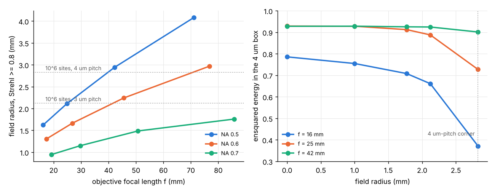

# Toward 10^6 sites: meta-optics for a million-qubit tweezer array

Technical report (meta-optics only; laser power and heating are treated separately, as requested
(USER)). Goals (USER): (i) can the trap-generating metasurface and the imaging meta-objective
reach ~10^6 sites, with NA, cell geometry and pitch free to change; (ii) can one meta-optic
serve any number of traps between 10 and 10^6, chosen by the size of the laser beam on it.
All numbers are SIM (review before submission) or DERIVED unless marked. Code:
scripts/objective_field_scan.py, scripts/million_imaging.py, scripts/million_mla.py,
scripts/scaling_100k.py; configs/million.yaml; results/million/, results/scaling_100k/.

## Summary

Result. A million sites is within reach of meta-optics. The difficult element is not the
trap-generating metasurface but a single objective that sees the whole array. The array is
1000 x 1000 sites, 4 mm square at 4 um pitch (corner 2.83 mm from the axis), or 3 mm square at
3 um pitch (corner 2.12 mm).

(i) Trap generation, two routes. A direct hologram on the present 18.4 mm chip already covers
this field: an exact-kernel site at 2.83 mm keeps ~0.95 of the axial depth, and spots stay
<= 0.82 um (SIM, single-site kernels). Its design, however, needs ~3 weeks on the present
4-core machine, or ~1 GPU-day (DERIVED). A metasurface lenslet array relayed by the
meta-objective scales by construction. With per-lenslet aberration pre-compensation it
restores the Strehl ratio over the full 2.83 mm field (1.0 in the ray model; 0.96 to 0.99 in a
wave-optics check). The lenslets then need only small
extra deflections: <= 0.15 with a 25 mm objective and 10x demagnification.

(ii) Imaging. For one common focal plane with Strehl >= 0.8 out to the 4 um-pitch corner, the
aplanatic meta-doublet needs f ~ 42 mm at NA 0.5 (42 mm plates). In wave optics it then puts
>= 0.90 of each atom's light in its 4 um box with <= 3.6 % in any neighbour, across the whole
10^6-site array. At 3 um pitch f ~ 25 mm suffices (field radius 2.11 mm). Higher NA costs
field quickly: NA 0.6 needs f ~ 77 mm (92 mm plates) for the same field, and NA 0.7 does not
reach it below 120 mm. The 16 mm doublet images to ~2.1 mm radius (66 % of the light in the
site box) and fails at 2.83 mm (37 %).

(iii) One optic for 10 to 10^6 traps. A direct (pupil-plane) hologram cannot do this.
Shrinking the beam on it reduces the NA, not the number of sites. The lenslet-array
architecture does it naturally: each illuminated lenslet makes one trap, so a flat-top beam of
side sqrt(N) p sets N at constant depth per trap. For 10x demagnification and 4 um pitch the
beam side runs from 0.13 mm (N = 10) to 40 mm (N = 10^6), at a constant 0.16 kW/cm^2 on the
lenslet array for 0.2 mK.

What must improve: wafer-scale (40 to 50 mm) metasurface fabrication, which needs DUV
lithography rather than e-beam; GPU-class computation for direct holograms beyond ~10^5 sites;
a large-format camera (>= 16 Mpx); and the pupil fill of the lenslet route, which a square
lenslet limits to 0.785 and a hexagonal lenslet raises to 0.91 to 0.93 (Section 4).

Figure 1. Left: field radius with a minimum common-plane Strehl ratio >= 0.8 for the air-spaced
aplanatic meta-objective (852.3 nm, cell stack with air gap 2.5 to 50 mm, construction to 1.6 R1)
versus focal length, at NA 0.5, 0.6 and 0.7; the dotted lines mark the 10^6-site corners. Right:
ensquared energy in the 4 um site box (wave optics, one common plane over 0 to 2.83 mm) for the
16, 25 and 42 mm objectives at NA 0.5; a diffraction-limited spot gives 0.93.

## 1. Requirements

| Quantity | 4 um pitch | 3 um pitch | 2.5 um pitch |
|---|---|---|---|
| Array side (10^3 x 10^3) | 4.0 mm | 3.0 mm | 2.5 mm |
| Corner field radius | 2.83 mm | 2.12 mm | 1.77 mm |
| Field angle at f = 16 / 25 / 42 mm | 10.0 / 6.5 / 3.8 deg | 7.5 / 4.9 / 2.9 deg | 6.3 / 4.1 / 2.4 deg |

Choice of pitch. A smaller pitch shrinks the field (field area ~ a^2). However, neighbouring
Airy patterns then overlap more: the first dark ring of an NA 0.5 spot at 1075 nm is at 1.3 um.
In addition, the interstitial background and the addressing crosstalk grow (Section 1 of
docs/prefab_checks_report.md). We take 3 um as the practical lower bound and 4 um as the
reference (ref. 4 of the proposal used 4.3 um; Manetsch et al. used 7.2 um).

## 2. The meta-objective: field versus focal length and NA

Method. The air-spaced aplanatic doublet (docs/metalens_report.md, Sections 1 to 3) at 852.3 nm,
designed through the cell stack (air gap g | 4 mm fused silica | 9 mm vacuum). The air gap sets
the focal length: R1 = R2 = H(NA), f = R1 / NA. The plate spacing is scanned near f, and the
aplanatic construction is extended to 1.6 R1 so that the focusing plate covers R2 plus the field
(the earlier designs used 1.1 R1, which slightly understated their field beyond ~0.8 mm).
For each design we find, by bisection, the largest field radius with a minimum Strehl ratio
>= 0.8 (and >= 0.5) over all field points in one common focal plane
(results/million/objective_field.json).

| NA | Air gap | f | Plate diameter | Field radius, Strehl >= 0.8 / >= 0.5 | Sites at 4 um / 3 um pitch (Strehl >= 0.8) |
|---|---|---|---|---|---|
| 0.5 | 2.5 mm | 16.2 mm | 16 mm | 1.62 / 1.97 mm | 0.33 M / 0.59 M |
| 0.5 | 10 mm | 24.9 mm | 25 mm | 2.11 / 2.58 mm | 0.56 M / 0.99 M |
| 0.5 | 25 mm | 42.2 mm | 42 mm | 2.94 / 3.61 mm | 1.08 M / 1.92 M |
| 0.5 | 50 mm | 71.1 mm | 71 mm | 4.08 / 5.04 mm | 2.08 M / 3.70 M |
| 0.6 | 2.5 mm | 17.4 mm | 21 mm | 1.30 / 1.62 mm | 0.21 M / 0.38 M |
| 0.6 | 10 mm | 26.8 mm | 32 mm | 1.66 / 2.09 mm | 0.35 M / 0.61 M |
| 0.6 | 25 mm | 45.5 mm | 55 mm | 2.24 / 2.83 mm | 0.63 M / 1.12 M |
| 0.6 | 50 mm | 76.8 mm | 92 mm | 2.97 / 3.82 mm | 1.10 M / 1.96 M |
| 0.7 | 2.5 mm | 19.2 mm | 27 mm | 0.95 / 1.22 mm | 0.11 M / 0.20 M |
| 0.7 | 10 mm | 29.7 mm | 42 mm | 1.15 / 1.50 mm | 0.17 M / 0.29 M |
| 0.7 | 25 mm | 50.8 mm | 71 mm | 1.49 / 1.93 mm | 0.28 M / 0.49 M |
| 0.7 | 50 mm | 85.8 mm | 120 mm | 1.76 / 2.36 mm | 0.39 M / 0.69 M |

Scaling. At NA 0.5 the field radius grows as ~f^0.6 (1.62, 2.11, 2.94 and 4.08 mm at f = 16, 25,
42 and 71 mm). This is slower than linearly, because the residual astigmatism and field
curvature scale as R x theta^2 ~ r^2 / f (Provisional). Higher NA costs field steeply, because
the same residual aberrations grow with the cone angle.

Imaging metric. Fluorescence imaging needs most of each atom's light in its own pitch-sized box
and little in the neighbours'; a Strehl ratio of 0.8 is a stricter requirement than that. We
compute the ensquared energy (EE) in the 4 um box and the largest neighbour-box fraction
from the wave-optics PSF (superposition method, Section 4b of the metalens report), in one
common plane over the whole field (results/million/imaging_ee.json).

Entries: ensquared energy in the 4 um box / largest neighbour-box fraction (ray Strehl in the common plane). A diffraction-limited NA 0.5 spot gives 0.93 / 0.014 on this grid.

| Objective f | 0 mm | 1 mm | 1.77 mm | 2.121 mm | 2.828 mm |
|---|---|---|---|---|---|
| 16 mm (gap 2.5 mm) | 0.79 / 0.045 (S 0.17) | 0.75 / 0.063 (S 0.15) | 0.71 / 0.087 (S 0.11) | 0.66 / 0.073 (S 0.09) | 0.37 / 0.242 (S 0.08) |
| 25 mm (gap 10 mm) | 0.93 / 0.014 (S 1.00) | 0.93 / 0.016 (S 1.00) | 0.91 / 0.030 (S 0.92) | 0.89 / 0.043 (S 0.79) | 0.73 / 0.082 (S 0.30) |
| 42 mm (gap 25 mm) | 0.93 / 0.014 (S 0.99) | 0.93 / 0.015 (S 0.99) | 0.93 / 0.019 (S 0.98) | 0.92 / 0.021 (S 0.96) | 0.90 / 0.036 (S 0.84) |

Hence the 42 mm objective images the 10^6-site array at 4 um pitch with >= 0.90 of the light in the site box and <= 3.6 % in any neighbour, the 25 mm objective does so to 2.12 mm (0.89 / 0.043; the 3 um-pitch corner, where the box is smaller and the EE correspondingly lower) and degrades to 0.73 / 0.082 at 2.83 mm, and the 16 mm objective, whose single plane is a compromise over the whole field, keeps 0.66 / 0.073 at 2.12 mm and fails at 2.83 mm (0.37 / 0.24).

3 um pitch, plane chosen for that field (results/million/imaging_ee_3um.json,
configs/imaging_1M_3um.yaml). The 3.0 mm array (corner 2.12 mm) is evaluated with a 3 um box
and a common plane chosen over 0 to 2.12 mm only; the 2.12 mm column of the table above used a
4 um box and the plane of the 2.83 mm field. Entries as above; the diffraction limit for the
3 um box is 0.916 / 0.016 (docs/scaling_100k.md).

| Objective f | 0 mm | 1.06 mm | 1.50 mm | 2.12 mm |
|---|---|---|---|---|
| 16 mm | 0.916 / 0.016 (S 1.00) | 0.911 / 0.023 (S 0.98) | 0.880 / 0.043 (S 0.87) | 0.631 / 0.115 (S 0.33) |
| 25 mm | 0.914 / 0.016 (S 0.99) | 0.911 / 0.020 (S 0.99) | 0.908 / 0.025 (S 0.97) | 0.858 / 0.051 (S 0.80) |
| 42 mm | 0.914 / 0.016 (S 1.00) | 0.914 / 0.017 (S 1.00) | running | running |

Choice of the common plane. The plane is chosen to maximise the minimum ray Strehl ratio over
the field. When the field edge cannot reach a useful Strehl ratio in any plane, this criterion
trades the whole inner field for a marginal gain at the edge. For the 16 mm objective over
0 to 2.83 mm it put the plane 4.24 um from focus: the on-axis Strehl ratio fell to 0.17 (EE 0.79)
for a corner Strehl ratio of 0.08. Over 0 to 2.12 mm the same lens keeps its plane within
0.04 um of focus and images to 1.5 mm with EE >= 0.88; its 2.12 mm corner (EE 0.63, 11.5 %
in a neighbour box) is beyond its field. Hence the 16 mm row of the 4 um table
reflects a poorly posed plane choice as much as the lens; an EE-based plane criterion would
raise its inner-field values (not recomputed). The 25 and 42 mm rows are not affected: their
corners stay above S 0.3 and 0.8, and their planes are within 0.3 um of focus.

Tolerances of the 42 mm imaging objective (ray model, common plane re-optimised per case,
field points -2.83 / 0 / +2.83 mm; results/million/tolerances_f42.json,
scripts/million_tolerances.py):

| Case | Strehl ratio at -2.83 / 0 / +2.83 mm |
|---|---|
| Nominal | 0.84 / 0.99 / 0.84 |
| Plate spacing +50 um / +200 um | 0.68 / 0.99 / 0.68; 0.23 / 0.96 / 0.23 |
| Cell wall +50 um (refocus -33 um) | 0.81 / 0.98 / 0.81 |
| Focusing plate decentred 2 / 5 / 10 um | 0.76 / 0.98 / 0.90; 0.61 / 0.91 / 0.96; 0.37 / 0.70 / 0.92 |
| Cell tilted 0.05 deg | 0.49 / 0.99 / 0.49 |
| Cell tilted 0.1 deg | 0.67 / 0.27 / 0.07 (refocus -3.7 um) |

Used to the edge of its field, the objective has no Strehl margin there. To hold the 0.8
criterion the spacing must be held to about 10 to 25 um and the plate centring to about 1 um
(DERIVED: linear and quadratic interpolation between the nominal and the 50 um and 2 um cases). The
wall thickness is uncritical, since a refocus absorbs it. The cell tilt rows are pessimistic:
they keep the evaluation plane perpendicular to the objective axis, while the atom plane tilts
with the cell. The depth of focus (+-lambda / (2 NA^2) = +-1.7 um) over the +-2.83 mm field
requires the atom plane and the objective axis to be perpendicular to ~0.6 mrad (0.03 deg),
or a matching tilt of the objective (DERIVED). For imaging, the ensquared energy is the
relevant metric and is far more forgiving than the Strehl ratio: the 25 mm objective at
2.83 mm (Strehl 0.30) still puts 0.73 of the light in the site box. Hence these tolerances
bound the Strehl criterion, not the imaging fidelity (Provisional; ensquared energy not
recomputed per case).

## 3. Trap generation route A: one direct hologram

Field. Exact per-site kernels have no field aberration. At the present cell geometry (15.5 mm
vacuum model) a single site keeps a relative depth of 0.983 at 1.6 mm, 0.968 at 2.3 mm, 0.940 at
3.2 mm and 0.887 at 4.5 mm, with spot half-widths <= 0.84 um. The largest meta-atom deflection
is 0.61 to 0.69, where the Si-rich supercells give eta ~ 0.66 to 0.70
(results/scaling_100k/hologram_large_field.json). Hence the 18.4 mm chip covers the
10^6-site field at 4 um pitch with ~5 % depth roll-off at the corners, which the design weights
remove.

Demonstrated so far. 99,856 sites (docs/scaling_100k.md): efficiency 0.83 and 7.5 % rms with
library pillars after two feedback rounds; the residual non-uniformity is uncorrelated
site-to-site scatter, with no field dependence. Re-rendering the design with an exact-accurate
render (below) gives 7.14 % against 7.05 % (ideal pillars). Hence the render grid is not the
cause, and the source of the residual, given 0.24 % in the pupil model, is unresolved
(docs/scaling_100k.md).

Computation at 10^6 (DERIVED from the 10^5 run). The wedge pupil grows with the field as
(r_max)^2: ~5.2 x 10^6 samples at 4 um pitch (2.9 x 10^6 at 3 um) against 0.52 x 10^6 for
10^5 sites. Each kernel product therefore needs ~5.2 x 10^12 evaluations, against 5 x 10^10. At
the measured 7 x 10^8 evaluations/s (numba, 4 cores) this is ~2 h per product and ~4 h per WGS
iteration, ~3 weeks for the 120 iterations of the v2 schedule. The kernel is a sum of
independent sincos terms, an ideal GPU workload.

Status of the 10^6 pipeline (code complete, not yet run at 10^6; docs/gpu_run.md):
(i) GPU kernels (hologram/lazy_gpu.py, numba.cuda): single-precision per-pair arithmetic with
Kahan-compensated sums, products split into launches of ~2 x 10^9 evaluations (well under the
2 s Windows display-driver timeout). Checked against the CPU kernels in the CUDA simulator
(relative error 1.6 x 10^-3, set by the float32 path lengths) and in the compiled PTX, where an
implicit int64 to float64 promotion had put sin/cos on the double-precision path (1/64 rate on
consumer GPUs) and was removed. Expected rate on an RTX 3050: 3 to 6 x 10^10 evaluations/s
(DERIVED from the instruction mix, not measured), i.e. 6 to 12 h for the design.
(ii) Memory-bounded rendering and metrics (hologram/tiled.py). No 44,500^2 fine render grid and
no full upsampled focal window are stored; the hologram field at each metasurface pixel is
evaluated directly from the coarse pupil grid with a Kaiser-windowed sinc, and the focal field
is upsampled and measured in 1024^2 tiles. Peak memory is a few GB (configs/fullaperture_1M.yaml).

Limitation for goal (ii). A pupil-plane hologram focuses every site through the whole
aperture. Illuminating a smaller part of it lowers the NA of all sites; it does not reduce
their number. A wafer carrying several holograms (e.g. 10, 10^2, ..., 10^6 sites), selected by
translation, is the hologram-route answer to goal (ii). Each still needs the full aperture
(~18 to 25 mm), so a 150 mm wafer holds ~6 to 20 of them.

## 4. Trap generation route B: metasurface lenslet array (scalable 10 to 10^6)

Architecture. A metasurface lenslet array (MLA) lies in the front focal plane of a tube lens
(focal length f_T = M f_obj) and is relayed onto the atoms by the meta-objective with
demagnification M. Each lenslet focuses its patch of a flat-top beam to one spot, so
N = (illuminated area) / p^2 at constant power per trap. This route was demonstrated with
refractive MLAs and a conventional objective: 75 um pitch, 1.1 mm focal length, 5.2 um final
pitch, 1.0 um waist, and "the number of sites with sufficient depth is proportional to the
available laser power" (Pause et al., [Optica 11, 222 (2024)](https://doi.org/10.1364/OPTICA.513551),
arXiv:2310.09191, read in session).

Geometry (results/million/mla.json; DERIVED). The lenslet pitch is p = M a and the lenslet
NA is NA_L = NA / M (it fills the objective pupil). The focal length is
f_L = M^2 a / (2 NA). The Fresnel number N_F = a NA / (2 lambda) is independent of M: 0.93 at
a = 4 um, 0.70 at 3 um (1075 nm). Each lenslet focus is therefore a Fourier-optics focus, and
its aperture field maps one-to-one onto the objective pupil.

| a | M | p | NA_L | f_L | MLA side for 10^6 | Lenslets per cm^2 |
|---|---|---|---|---|---|---|
| 4 um | 5 | 20 um | 0.10 | 100 um | 20 mm | 250,000 |
| 4 um | 10 | 40 um | 0.05 | 400 um | 40 mm | 62,500 |
| 4 um | 20 | 80 um | 0.025 | 1.6 mm | 80 mm | 15,625 |
| 3 um | 10 | 30 um | 0.05 | 300 um | 30 mm | 111,111 |

Per-lenslet aberration pre-compensation. A metasurface lenslet can carry, besides its focusing
phase, minus the objective's wavefront error at its own image position. Its aperture maps onto
the objective pupil, with p/2 corresponding to R1. This is the lenslet-array counterpart of
the hologram's exact kernels, and it removes the objective's field limit for the trapping path.
Ray model at 1075 nm, NA 0.5, one common atom plane over 0 to 2.83 mm:

| Objective | Field | Strehl before / after | Correction W, PV / rms | Extra lenslet deflection, M = 5 / 10 / 20 |
|---|---|---|---|---|
| f = 16 mm | 0 / 1.77 / 2.83 mm | 0.13 / 0.09 / 0.08 -> 1.000 | 0.7 / 1.0 / 2.1 waves PV | up to 0.81 / 0.40 / 0.20 |
| f = 25 mm | 0 / 1.77 / 2.83 mm | 1.00 / 0.95 / 0.47 -> 1.000 | 0.03 / 0.19 / 0.77 waves PV | up to 0.30 / 0.15 / 0.07 |

(The low "before" values for the 16 mm objective include the compromise focus of one plane over
the whole field; the correction also removes that defocus.) Wave-optics check (superposition method of Section 4b of the metalens
report, the correction W applied at the stop from a 96 x 96 sampling with linear interpolation;
results/million/mla_wavecheck.json): at the 2.83 mm corner the Strehl ratio rises from 0.117 to
0.964 (f = 16 mm) and from 0.467 to 0.987 (f = 25 mm). The uncorrected values agree with the
ray model (0.079, 0.473). The 1 to 4 % shortfall from 1.0 is consistent with the coarse sampling
of the correction (Provisional). Hence the trapping side reaches
10^6 sites at 4 um pitch with a 25 mm meta-objective, using M = 10 lenslets (NA_L = 0.05 plus
<= 0.15 of correction deflection), or even with the present 16 mm objective at M = 20. The
plates must cover R2 plus the field (an 8.1 + 2.8 mm radius for the 16 mm design).

Pupil fill. Because N_F ~ 1, each lenslet aperture is imaged into the objective pupil: the
uniformly lit aperture shape is the pupil amplitude. A phase on the lenslet cannot reshape it
into a disc. (An earlier draft of this report assumed a square-to-circle phase mapping with
~0.95 fill. That mapping needs geometric-optics propagation over many Fresnel lengths, which
the lenslet does not have.) The focal peak per watt, relative to a uniformly filled disc, is
|S n D|^2 / (|S| pi) for an aperture S and the pupil disc D (results/million/pupil_fill.json,
scripts/million_pupil_fill.py; DERIVED, numerical):

| Lenslet aperture (scaled to the stop radius R1) | Transmitted through the stop | Peak per watt |
|---|---|---|
| Square, circumscribing the stop (half-width R1) | 0.785 | 0.785 |
| Square, inscribed (half-width 0.71 R1) | 1.00 | 0.637 |
| Square, optimum (half-width 0.91 R1) | 0.888 | 0.831 |
| Hexagon, circumscribing (inradius R1) | 0.907 | 0.907 |
| Hexagon, optimum (inradius 0.96 R1) | 0.956 | 0.929 |

A hexagonal lenslet array gains 18 % in depth per watt over the circumscribed square, but
produces a triangular trap lattice. A square lattice keeps the square lenslet, best slightly
under-filled (0.831). Light outside the stop is lost there, not scattered towards the atoms.

Power scaling at constant depth. Efficiency chain (Provisional): lenslet ~0.95 (eta at
s <= 0.1 from the supercell curve); pupil fill 0.785 (square) or 0.929 (hexagon, optimum);
tube lens ~0.98 `[VALUE?]`; meta-objective ~0.80; total ~0.57 (square) or ~0.67 (hexagon).
Relative to the direct hologram (0.83), and with NA 0.5 instead of 0.55, the depth per watt per
site is ~80 mK x site/W (square) or ~95 mK x site/W (hexagon), against the hologram's
140.6 mK x site/W. For 0.2 mK traps (square lenslets):

| N | Flat-top side on the MLA (M = 10, a = 4 um) | Power (pi/4 fill) | Intensity on the MLA |
|---|---|---|---|
| 10 | 0.13 mm | 25 mW | 0.16 kW/cm^2 |
| 10^3 | 1.3 mm | 2.5 W | 0.16 kW/cm^2 |
| 10^5 | 12.6 mm | 250 W | 0.16 kW/cm^2 |
| 10^6 | 40 mm | 2.5 kW | 0.16 kW/cm^2 |

The depth per trap stays fixed because the intensity on the MLA stays fixed; only the beam
size changes. A zoom range of 300 is impractical in one telescope. Two to three exchangeable
expanders with a refractive flat-top shaper would cover it, and below ~100 traps a Gaussian
beam on a few lenslets suffices if some depth variation is acceptable. The edge lenslets of a
square flat-top are partially lit: ~4 sqrt(N) of N sites, 0.4 % at 10^6, to be discarded.
Uniformity is set by the flat-top profile and the lenslet efficiencies, not by a design
algorithm. A low-resolution SLM imaged onto the MLA could equalise the depths by camera
feedback, as WGS does for holograms (not simulated). Interference between neighbouring traps
(same laser, equal lenslet pistons) can be minimised by per-lenslet piston phases, another
degree of freedom a metasurface provides. The zero order of the lenslets reaches the atoms
as a plane wave of relative intensity ~0.03 x (pi w^2 / 2) / a^2 ~ 2 x 10^-3 of a trap peak
(DERIVED), which is negligible.

## 5. Practical feasibility and what must improve

| Element | Size for 10^6 (4 um pitch) | Status | What must improve |
|---|---|---|---|
| Direct hologram (route A) | 18.4 mm chip (as now) | fabrication as for v2 | design computation on GPU (~1 GPU-day); more feedback rounds for uniformity |
| Lenslet array (route B) | 40 mm (M = 10) | low NA_L, easy meta-atoms | wafer-scale patterning (DUV lithography `[REF?]`); pupil fill (0.785 square, 0.93 hexagon) |
| Trapping meta-objective (route B) | 25 mm plates | as the present doublet, scaled | plate size; alignment as Section 7 of the metalens report |
| Imaging meta-objective | 42 mm plates at NA 0.5 (25 mm at 3 um pitch) | design exists (aplanat) | 42 to 50 mm wafer-scale metasurfaces; or field-dependent correction in image space (below) |
| Camera | >= 4000 x 4000 pixels | `[VALUE?: large-format sCMOS]` | or field splitting onto 4 cameras |
| Cell | 4 mm wall, 9 mm vacuum | unchanged | thinner cells do not help the field (Section 6) |

Imaging beyond the single-objective field. The imaging counterpart of per-lenslet
pre-compensation is a corrector array placed slightly behind an intermediate image. At
magnification M_i the atoms' beams are separated there, if the distance d from the image
satisfies d < a M_i / (2 NA / M_i). Each element can then remove the field-dependent aberration
of its own atom before a second relay to the camera. By reciprocity, the corrected
point-spread function equals that with -W applied at the stop. We computed it in wave optics
(superposition method, 852.3 nm, NA 0.5, one common plane, W from a 96 x 96 ray sampling;
results/million/imaging_corrected.json, scripts/million_imaging_corrected.py). Entries are
ensquared energy in the 4 um box / largest neighbour-box fraction:

| Objective | Field radius | Uncorrected | Corrected |
|---|---|---|---|
| f = 16 mm | 1.77 mm | 0.71 / 0.088 | 0.928 / 0.015 |
| f = 16 mm | 2.12 mm | 0.67 / 0.082 | 0.928 / 0.015 |
| f = 16 mm | 2.83 mm | 0.39 / 0.216 | 0.928 / 0.015 |
| f = 25 mm | 1.77 mm | 0.92 / 0.025 | 0.928 / 0.015 |
| f = 25 mm | 2.12 mm | 0.89 / 0.045 | 0.928 / 0.015 |
| f = 25 mm | 2.83 mm | 0.73 / 0.084 | 0.928 / 0.015 |

The diffraction-limited values on this grid are 0.93 / 0.014. Hence, with an ideal per-atom
corrector, even the present 16 mm objective images the full 10^6-site field at 4 um pitch. The
model leaves out the corrector array itself (its fill factor and the overlap of neighbouring
beams at its plane), the second relay, and the alignment of the array to the field. The
correction is static, so the corrector array is a fixed metasurface matched to one objective
and one cell.

## 6. Does a thinner cell or a closer lens help?

No, for the field. The field radius is set by the focal length and NA of the objective, and
shortening the distance to the atoms shrinks f (docs/scaling_100k.md: the 3 mm in-vacuum doublet
images only ~0.45 mm radius). A thinner wall (e.g. 2 mm instead of 4 mm) does not change the
achievable field, since the design corrects the wall exactly. It does halve the sensitivity to
wall thickness and tilt errors (Section 7 of the metalens report). For a million sites the lens
should go further away, not closer, with f ~ 25 to 42 mm.

## 7. Recommendation

For 10^6 sites at 4 um pitch, with flexibility from 10 to 10^6 traps:
(i) Trapping: a metasurface lenslet array (M = 10, 40 um pitch, NA_L 0.05, per-lenslet
aberration correction) relayed by a 25 mm aplanatic meta-objective. N follows the flat-top beam
size at constant depth.
(ii) Imaging: a 42 mm aplanatic meta-objective at NA 0.5 on the other side of the cell, or 25 mm
at 3 um pitch, with a >= 16 Mpx camera.
(iii) Keep the direct hologram as the high-efficiency option for a fixed N (0.83 against ~0.6),
once GPU design is available.
Next logical steps: a wave-optics simulation of a lenslet patch through the relay with the
correction; the square-to-circle lenslet design; a GPU port of the lazy kernels; and the imaging
corrector-array concept.

## Verification notes

Provenance ledger:

| Value | Location | Type | Pointer |
|---|---|---|---|
| Field radii vs f and NA | Section 2 | SIM, review before submission | results/million/objective_field.json |
| Ensquared energies | Section 2 | SIM, review before submission | results/million/imaging_ee.json |
| Ensquared energies, 3 um pitch | Section 2 | SIM, review before submission | results/million/imaging_ee_3um.json |
| Image-space correction | Section 5 | SIM, review before submission | results/million/imaging_corrected.json |
| 42 mm objective tolerances | Section 2 | SIM, review before submission | results/million/tolerances_f42.json |
| Pupil fill | Section 4 | DERIVED (numerical) | results/million/pupil_fill.json |
| Lenslet pre-compensation | Section 4 | SIM, review before submission | results/million/mla.json, mla_wavecheck.json |
| Hologram large-field depth | Section 3 | SIM | results/scaling_100k/hologram_large_field.json |
| 10^5-site design results | Section 3 | SIM | results/fullaperture_100k |
| Pause et al. MLA parameters | Section 4 | SOURCE | arXiv:2310.09191 (HTML, read in session) |
| Lenslet geometry, N_F, power table, zero-order ratio | Sections 4, 5 | DERIVED | formulas in text |
| Compute estimates | Section 3 | DERIVED | from the measured 10^5 run rate |

Open placeholders: `[VALUE?: GPU sincos throughput]`, `[VALUE?: tube lens transmission]`,
`[VALUE?: large-format camera]`, `[REF?: wafer-scale DUV metasurface lithography]`.
